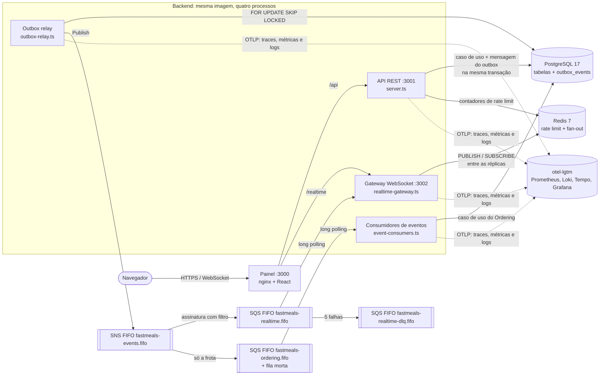
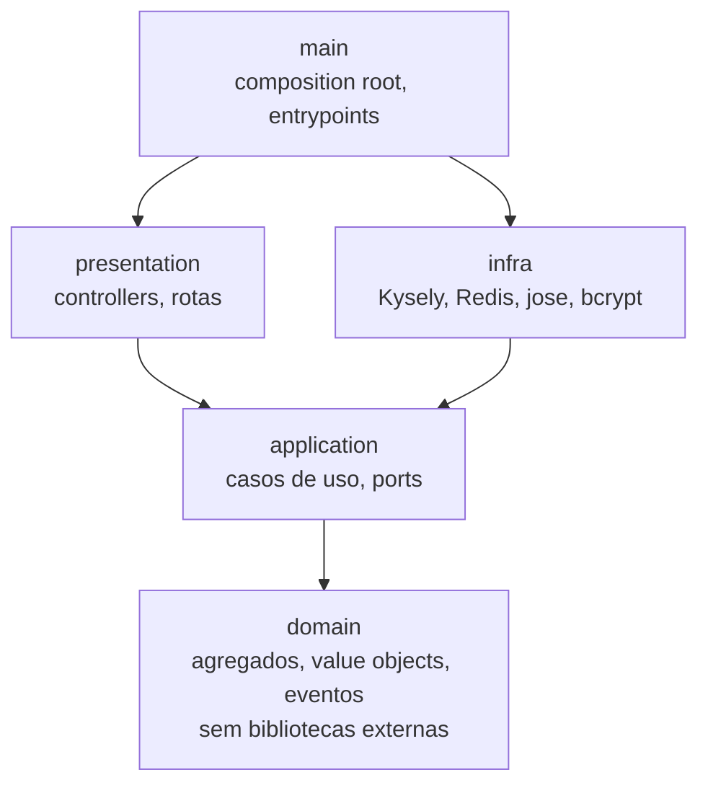
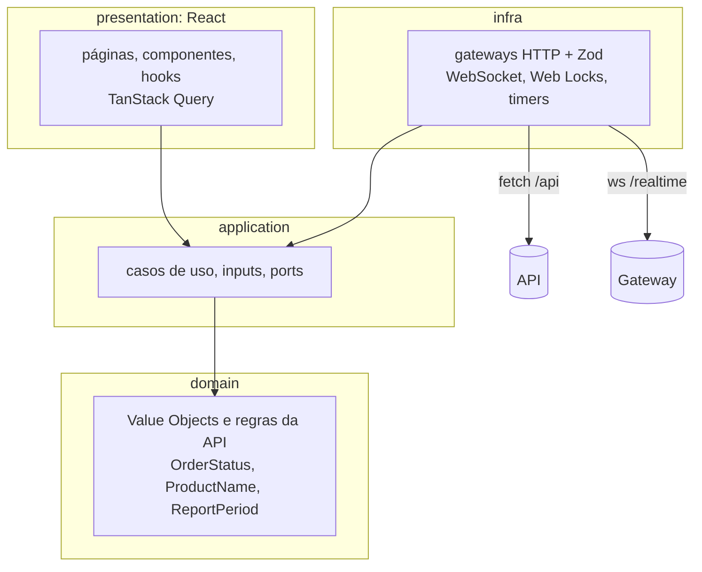
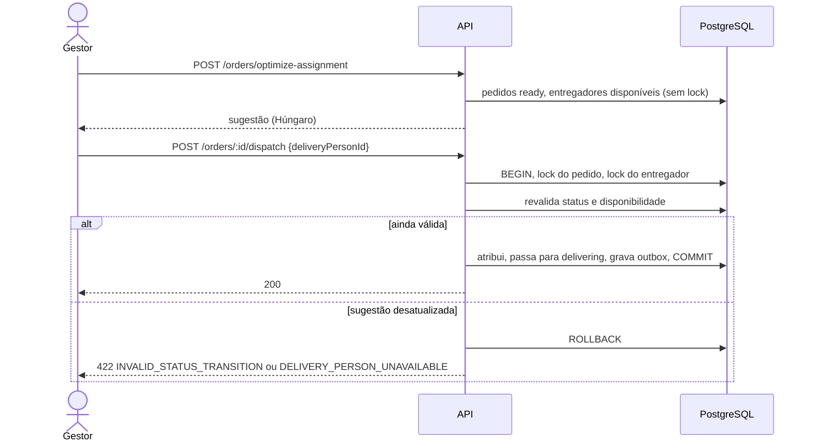

# DECISIONS — FastMeals

Este documento registra as decisões técnicas do projeto: por que cada biblioteca foi escolhida, como funciona o algoritmo de atribuição de entregadores, as decisões de arquitetura (no formato de ADRs, com alternativas e consequências), as mudanças no esquema de referência e as dificuldades encontradas.

> **Escopo:** o projeto inteiro — o backend ([`backend/`](backend), instruções em [`backend/README.md`](backend/README.md)), o painel ([`frontend/`](frontend), instruções em [`frontend/README.md`](frontend/README.md)) e o [`docker-compose.yml`](docker-compose.yml) da raiz, que sobe tudo com `docker compose up --build`. As ADRs 01–13 tratam do backend e da infraestrutura; as ADRs 14–21, do painel.

## Sumário

1. [Visão geral](#1-visão-geral)
2. [Bibliotecas](#2-bibliotecas)
3. [Algoritmo de atribuição de entregadores](#3-algoritmo-de-atribuição-de-entregadores)
4. [Decisões de arquitetura (ADRs)](#4-decisões-de-arquitetura-adrs)
5. [Mudanças no esquema de referência](#5-mudanças-no-esquema-de-referência)
6. [Dificuldades encontradas e como foram resolvidas](#6-dificuldades-encontradas-e-como-foram-resolvidas)
7. [Limitações conhecidas e próximos passos](#7-limitações-conhecidas-e-próximos-passos)

---

## 1. Visão geral

O projeto tem duas aplicações. O **backend** é um **monólito modular**: um repositório, uma imagem Docker e quatro processos com responsabilidades diferentes. Os eventos saem do outbox por **SNS + SQS** (no Floci em desenvolvimento), com fila morta ([ADR-22](#adr-22--eventos-por-sns--sqs-com-fila-morta-e-o-redis-só-para-o-fan-out)). O **painel** (React) é servido por um nginx que também faz o proxy da API e do WebSocket na mesma origem.



Dentro do código, cada **bounded context** (`identity`, `catalog`, `ordering`, `delivery`, `reporting`, `realtime`) tem as camadas `domain → application → infra → presentation` e é montado em `main/`. Um `shared-kernel` guarda o que é comum (agregados, eventos, unit of work, HTTP, paginação, datas).



As setas são as únicas dependências permitidas, e isso é verificado por testes de arquitetura ([ADR-11](#adr-11--regras-de-arquitetura-verificadas-por-testes)).

O **painel** segue a mesma organização ([ADR-14](#adr-14--o-painel-com-a-mesma-arquitetura-do-backend)): os mesmos contextos (`identity`, `catalog`, `ordering`, `delivery`, `reporting`, `realtime`), as mesmas camadas e as mesmas regras verificadas por ArchUnitTS. O React fica só em `presentation` e `main`.



---

## 2. Bibliotecas

Critério geral: cada biblioteca resolve um problema concreto que não vale reimplementar, e fica **presa à camada de infra ou de apresentação**. O domínio e os casos de uso não importam nenhuma delas (exceto Zod na validação de entrada), então trocar qualquer uma afeta só um adapter.

### Backend — produção

| Biblioteca | Para quê | Por que ela | Alternativas consideradas |
|---|---|---|---|
| **Fastify 5** | Servidor HTTP da API e do gateway | Erros de handlers `async` tratados nativamente; plugins encapsulados (cookie, rate limit, websocket) mantidos pelo próprio time; `inject()` para testes e2e sem abrir porta; bom desempenho de serialização. O Fastify só aparece em `presentation`/`main`: controllers recebem um `HttpRequest` próprio. | **Express 5**: tratamento async chegou só na v5 e quase tudo vem de middlewares de terceiros. **Koa**: minimalista demais para rate limit, cookies e websocket integrados. |
| **Kysely** + **pg** | Acesso ao PostgreSQL e migrations | Query builder com tipos inferidos do schema, mas é SQL: os relatórios agrupam por dia local de São Paulo, o relay usa `FOR UPDATE SKIP LOCKED`, as escritas usam `FOR UPDATE`/`FOR SHARE`, e existem índices parciais e trigram. Tudo isso é natural em Kysely e trabalhoso num ORM. Não impõe modelo: o agregado é do domínio e um mapper converte linha ↔ agregado. `pg` é o driver padrão, com pool. | **Prisma** / **TypeORM**: o modelo gerado (ou com decorators) compete com o agregado DDD, e locks, `SKIP LOCKED` e agregações com fuso acabariam em SQL cru. **Drizzle**: alternativa próxima; Kysely foi escolhido por ser só query builder (sem camada de ORM) e ter migrations simples em TypeScript. **Knex**: tipagem fraca. |
| **OpenTelemetry** (SDK Node, OTLP, instrumentações de HTTP, `pg`, `ioredis`, pino e `@fastify/otel`) | Traces, métricas e logs dos três processos | Padrão aberto: o mesmo código exporta para qualquer backend OTLP. A propagação W3C atravessa o outbox e o SNS/SQS ([ADR-26](#adr-26--observabilidade-com-opentelemetry-um-trace-por-ação-métricas-de-negócio-e-logs-correlacionados)). | `prom-client` (só métricas), Datadog/New Relic APM (presos a um fornecedor) |
| **@aws-sdk/client-sns** + **@aws-sdk/client-sqs** | Publicar eventos, consumir a fila do tempo real, fila morta e redrive | SDK oficial v3, modular (só os dois clientes), com `AbortSignal` para interromper o long polling no shutdown e `AWS_ENDPOINT_URL` para apontar ao emulador sem mudar código. | `sqs-consumer` (abstrai o laço, mas esconde o controle de apagar só depois de repassar e do encerramento), LocalStack SDKs |
| **ioredis** | Rate limit distribuído e fan-out do tempo real entre as réplicas do gateway | Reconexão automática, scripts Lua (o contador faz `INCR` + `PEXPIRE` atomicamente), suporte a Cluster/Sentinel se o Redis crescer, conexão dedicada para `SUBSCRIBE`. | **node-redis**: equivalente; ioredis tem API de Lua e reconexão mais diretas. |
| **jose** | Emissão e verificação de JWT (HS256) | Implementação fiel às RFCs, sem dependências, API `async`, validação de `audience`/`issuer`/expiração embutida (access e refresh usam segredos e audiences diferentes). | **jsonwebtoken**: API de callbacks, CommonJS, menos rigor por padrão. |
| **@node-rs/bcrypt** | Hash de senhas (custo ≥ 10) | bcrypt nativo (Rust) que roda **fora do event loop**, com binários pré-compilados (sem `node-gyp` no Docker). Um login não trava as outras requisições. | **bcryptjs**: JavaScript puro, bloqueia o event loop e é várias vezes mais lento. **bcrypt**: nativo, mas compila com `node-gyp`. **argon2**: mais moderno, mas o enunciado pede bcrypt. |
| **Zod 4** | Validação de entrada HTTP, variáveis de ambiente e `seed/data.json` | Esquema e tipo TypeScript da mesma fonte; mensagens em português por campo; coerção de query string. Cada processo valida o ambiente no boot e falha com mensagem clara. | **JSON Schema do Fastify** (Ajv): prenderia a validação ao framework e não daria o tipo. **class-validator**: depende de decorators e classes. |
| **@fastify/cookie** | Cookie `httpOnly` do refresh token | Plugin oficial, com as opções `httpOnly`/`SameSite`/`Secure`/`Path`. | — |
| **@fastify/swagger** + **@fastify/swagger-ui** | Documentação OpenAPI e Swagger UI em `/api/docs` | Plugins oficiais. O modo estático recebe um documento pronto, gerado dos mesmos schemas Zod que validam a entrada ([ADR-27](#adr-27--documentação-openapi-gerada-dos-schemas-zod-e-conferida-contra-as-respostas-reais)). | **fastify-type-provider-zod**: geraria o documento pelas rotas, mas exigiria validar pelo Fastify, que hoje não conhece os controllers. **zod-openapi** / **@asteasolutions/zod-to-openapi**: desnecessários, o Zod 4 já converte para JSON Schema. |
| **@fastify/rate-limit** | 100 req/min por IP | Plugin oficial com `Retry-After`; aceita um *store* customizado, que aponta para o contador no Redis (limite compartilhado entre réplicas). | Middleware próprio: reimplementaria cabeçalhos e janela. |
| **@fastify/websocket** + **ws** | Gateway em tempo real | Integra o WebSocket ao ciclo de vida do Fastify (health check, shutdown) usando `ws`, a implementação mais usada e estável em Node. `ws` é dependência direta para não ser embutida no bundle ([dificuldade 5](#6-dificuldades-encontradas-e-como-foram-resolvidas)). | **Socket.IO**: protocolo próprio, fallback para long polling e cliente obrigatório; para um painel moderno, WebSocket puro basta. **SSE**: serviria (o fluxo é só servidor → cliente), mas WebSocket deixa a reautenticação na mesma conexão. |

### Backend — desenvolvimento e testes

| Biblioteca | Para quê | Por que ela |
|---|---|---|
| **TypeScript** (estrito) | Linguagem | `strict`, `noUncheckedIndexedAccess`, `exactOptionalPropertyTypes`, sem `any`. Resolução `Bundler`: imports sem `.js`. |
| **tsx** | `npm run dev` | Executa TypeScript direto, com recarga, sem build. |
| **tsup** | Build de produção | Um bundle ESM por entrypoint (API, relay, gateway, migrate, seed) com esbuild; dependências ficam externas. Resolve os imports sem extensão, que o `tsc` puro não emitiria de forma executável. |
| **Vitest** | Testes | ESM e TypeScript nativos (o Jest ainda trata ESM como experimental), *projects* separando unit / architecture / integration / e2e, *fake timers* para o relay e o gateway. |
| **Floci** | SNS e SQS locais (Compose e testes) | Emulador da AWS MIT, em uma imagem com healthcheck HTTP; tem redrive (`RedrivePolicy`, `StartMessageMoveTask`), filtro de assinatura e entrega crua. Alternativa: LocalStack, cuja edição gratuita passou a exigir token. |
| **Testcontainers** | PostgreSQL, Redis e Floci reais nos testes | Constraints, locks, `EXPLAIN`, fusos e concorrência só são testados de verdade no banco real. Os containers sobem uma vez por execução e são destruídos ao final. Nada a configurar à mão. |
| **ArchUnitTS** | Testes de arquitetura | As regras de camadas, contextos e convenções viram testes do Vitest, com mensagens claras. Alternativas: **dependency-cruiser** (configuração JSON fora da suíte de testes) e **eslint-plugin-boundaries** (só dependências, sem regras de conteúdo como "todo caso de uso implementa `UseCase`"). |
| **@apidevtools/swagger-parser** | Validar o documento OpenAPI | Confere o documento contra a especificação OpenAPI 3.1 no teste e2e. |
| **Oxlint** + **oxlint-tsgolint** | Lint | Lê TypeScript sozinho e faz a análise com tipos sobre o TypeScript 7 nativo, que o `typescript-eslint` não suporta (ver [ADR-25](#adr-25--esteira-no-github-actions-e-lint-com-oxlint)). Roda o projeto inteiro em segundos. |

### Frontend — produção

| Biblioteca | Para quê | Por que ela | Alternativas consideradas |
|---|---|---|---|
| **React 19** | Interface | Exigido pelo enunciado (18+). A versão 19 traz `use()` para contextos, `ref` como prop e o contexto como provider (`<Context value>`), o que deixa os providers dos contextos curtos. | — |
| **React Router 8** | Rotas | Rotas como objetos (`RouteObject`), cada contexto exporta as suas, e `main` as compõe. `useSearchParams` guarda filtros e paginação na URL. `lazy` + `Suspense` dividem o código por tela. | **TanStack Router**: tipos melhores para *search params*, mas mais conceitos para o tamanho do painel; os filtros já são validados pelos inputs da aplicação. |
| **TanStack Query 5** | Estado vindo do servidor (listas, detalhes, relatórios) | Cache por chave, cancelamento (`AbortSignal` até o `fetch`), *retry* só para falhas transitórias, `keepPreviousData` (a lista anterior fica na tela enquanto a nova chega), invalidação por prefixo (o tempo real só invalida) e atualização otimista com rollback (disponibilidade do produto). | **Redux Toolkit/RTK Query**, **Zustand**, **Context API**: ver [ADR-15](#adr-15--estado-o-servidor-no-tanstack-query-a-url-para-filtros-sem-store-global). |
| **Zod 4** | Contrato das respostas da API e configuração | Toda resposta é validada antes de virar agregado: uma mudança no backend vira um erro claro ("resposta fora do contrato"), não um `undefined` na tela. | Tipos só em TypeScript: somem em tempo de execução. |
| **Recharts 3** | Gráficos dos relatórios (área, barras, rosca) | Componentes React em SVG com tooltip, eixos e responsividade prontos; cores lidas dos tokens do tema (claro/escuro). Fica só no chunk da tela de relatórios. | **Chart.js**: canvas, sem componentes React nativos e menos acessível. **Nivo/visx**: mais pesados ou mais baixo nível. **SVG à mão**: zero dependência, mas mais código para manter. |

Sem biblioteca de componentes nem de CSS ([ADR-19](#adr-19--estilo-css-modules-design-tokens-e-componentes-próprios-acessíveis)): CSS Modules com design tokens e componentes próprios acessíveis.

### Frontend — desenvolvimento e testes

| Biblioteca | Para quê | Por que ela |
|---|---|---|
| **Vite 8** | Dev server e build | Recarga instantânea, proxy de `/api` e `/realtime` na mesma origem (o cookie `httpOnly` funciona sem CORS) e build com divisão por rota. |
| **Vitest + Testing Library** | Testes | Os mesmos *projects* do backend (unit / integration / architecture). Testing Library consulta por papel e nome acessível (`getByRole('button', { name: 'Entrar' })`), então os testes também verificam a acessibilidade. |
| **MSW 3** | API e WebSocket simulados nos testes | Intercepta o `fetch` **e o WebSocket** no Node: as telas são testadas inteiras, com o cliente HTTP, a renovação de token e a conexão em tempo real reais. Requisição sem handler falha o teste, então nada sai para a rede. |
| **ArchUnitTS** | Testes de arquitetura | As mesmas regras do backend, mais regras do navegador ([ADR-14](#adr-14--o-painel-com-a-mesma-arquitetura-do-backend)). |
| **Playwright** | Testes de ponta a ponta | Chromium contra a stack completa e isolada no Docker. Contextos de navegador independentes permitem testar o tempo real entre dois gestores, e o relatório guarda trace, vídeo e screenshot das falhas. |
| **Oxlint** | Lint | As mesmas regras com tipo do backend, mais hooks do React e acessibilidade (`jsx-a11y`). |

`npm audit` está zerado nos dois projetos. A única vulnerabilidade herdada (via ArchUnitTS, sem correção publicada) foi neutralizada com um `overrides` restrito ([dificuldade 9](#6-dificuldades-encontradas-e-como-foram-resolvidas)).

---

## 3. Algoritmo de atribuição de entregadores

Código: [`hungarian.ts`](backend/src/delivery/domain/dispatch/algorithms/hungarian.ts), [`dispatch-optimizer.ts`](backend/src/delivery/domain/dispatch/services/dispatch-optimizer.ts), [`geo-point.ts`](backend/src/delivery/domain/location/geo-point.ts), [`suggest-assignment.usecase.ts`](backend/src/delivery/application/usecases/suggest-assignment/suggest-assignment.usecase.ts).

### 3.1 O problema

Dados `n` pedidos `ready` e `m` entregadores disponíveis, escolher pares pedido → entregador tal que:

- cada entregador recebe **no máximo um** pedido e cada pedido **no máximo um** entregador;
- o número de pares é o máximo possível, `k = min(n, m)`;
- a **soma das distâncias** entre cada entregador e o seu pedido é mínima.

É o **problema de atribuição** (emparelhamento perfeito de custo mínimo num grafo bipartido). A versão retangular (`n ≠ m`) é o caso normal aqui.

**Quem entra no cálculo:**

- **Pedidos:** todos os `ready`, inclusive os que já têm entregador atribuído (o gestor pode redistribuir).
- **Entregadores:** ativos, não removidos, sem pedido `delivering` e **com localização conhecida**. Os sem GPS são devolvidos em `unlocatedDeliveryPersons`, para o painel mostrar por que não foram usados.

### 3.2 Distância: Haversine

Distância geodésica sobre uma esfera de raio médio `R = 6371 km`:

```
a = sin²(Δφ/2) + cos φ1 · cos φ2 · sin²(Δλ/2)
c = 2 · atan2(√a, √(1 − a))
d = R · c
```

Para distâncias urbanas, o erro de tratar a Terra como esfera (≈ 0,5%) é muito menor que a diferença entre linha reta e rota real. A distância por ruas exigiria um serviço de rotas (OSRM, Google), fora do escopo; ver [limitações](#7-limitações-conhecidas-e-próximos-passos).

### 3.3 Algoritmo Húngaro (Kuhn–Munkres) com potenciais

A implementação é a versão O(n²·m) com **potenciais duais** (`u` nas linhas, `v` nas colunas), que insere uma linha por vez:

1. Mantém a invariante `custo[i][j] − u[i] − v[j] ≥ 0` (custo reduzido não negativo).
2. Para cada linha nova, procura o **caminho aumentante de menor custo reduzido** até uma coluna livre, num laço parecido com o de Dijkstra. A cada passo, ajusta os potenciais pelo menor custo reduzido encontrado (`delta`), o que cria pelo menos uma aresta de custo reduzido zero.
3. Ao achar uma coluna livre, inverte o caminho: cada coluna do caminho passa para a linha anterior, e a linha nova entra no emparelhamento.
4. No fim, as arestas de custo reduzido zero formam o emparelhamento ótimo (a dualidade de programação linear garante a otimalidade).

**Matriz retangular.** O algoritmo exige `linhas ≤ colunas`. O otimizador monta a matriz com o lado menor nas linhas: pedidos × entregadores quando há mais entregadores, e a **transposta** (entregadores × pedidos) quando há mais pedidos. Assim nunca é preciso completar a matriz com linhas fictícias de custo zero, que fariam o trabalho subir para O(K³).

**Determinismo.** Pedidos e entregadores são ordenados por ID antes do cálculo, e em caso de empate de custo vence a coluna de menor índice. A mesma entrada gera sempre o mesmo plano: o painel não "pisca" com sugestões diferentes a cada clique, e os testes são reprodutíveis.

### 3.4 Complexidade

Com `k = min(n, m)` e `K = max(n, m)`:

| Etapa | Tempo | Memória |
|---|---|---|
| Matriz de distâncias (Haversine) | O(n·m) | O(n·m) |
| Húngaro | O(k²·K) | O(K) extra |
| **Total** | **O(n·m + k²·K)** | **O(n·m)** |

No cenário do enunciado (50 pedidos × 30 entregadores), são cerca de 30² × 50 = 45 mil passos internos.

### 3.5 Casos de borda

| Situação | Resultado |
|---|---|
| Nenhum entregador disponível | Nenhuma atribuição; todos os pedidos em `unassigned` com `reason: "No available delivery person"` |
| Nenhum pedido `ready` | Resposta vazia (`assignments: []`, `totalDistanceKm: 0`) |
| Mais pedidos que entregadores | Os `m` pares de menor distância total; os demais pedidos em `unassigned` |
| Mais entregadores que pedidos | Todo pedido atribuído; entregadores excedentes ficam livres |
| Entregador sem localização | Fora do cálculo, listado em `unlocatedDeliveryPersons` |
| Entregador inativo, removido ou em entrega | Não é candidato |
| Empates de distância | Desempate determinístico por ID |
| Coordenadas inválidas | Recusadas na criação do `GeoPoint` (latitude fora de ±90, longitude fora de ±180, valores não finitos) |

### 3.6 Benchmark

Instâncias aleatórias na região de São Paulo, com semente fixa. Mediana do tempo do Húngaro (sem montar a matriz) e quanto **mais distância total** as heurísticas gulosas produzem em relação ao ótimo. Medido num Apple M2 com Node 24.

| Pedidos × entregadores | Húngaro | Guloso por pedido¹ | Guloso global² |
|---|---|---|---|
| 10 × 6 | 0,04 ms | +65% | +0,8% |
| **50 × 30 (enunciado)** | **0,15 ms** | **+129%** | **+6%** |
| 100 × 100 | 3,3 ms | +38% | +25% |
| 200 × 150 | 3,6 ms | +138% | +10% |
| 500 × 500 | 175 ms | +52% | +31% |
| 1000 × 1000 | 2,0 s | +54% | +39% |

¹ *Nearest neighbor*: cada pedido, em sequência, pega o entregador livre mais próximo.
² Ordena todos os pares por distância e aceita os que não conflitam.

Leitura:

- No cenário do enunciado, o ótimo custa **0,15 ms**, quatro ordens de grandeza abaixo do limite de 2 s. O endpoint inteiro (consultas no PostgreSQL incluídas) fica bem abaixo disso, verificado por teste automatizado.
- As heurísticas gulosas economizam pouco tempo e pagam caro em distância. O guloso por pedido chega a **mais que dobrar** a distância total, porque os primeiros pedidos "roubam" entregadores que fariam mais falta aos seguintes.
- O crescimento é cúbico. Acima de ~1000 × 1000 o tempo se aproxima de segundos; ver [limitações](#7-limitações-conhecidas-e-próximos-passos).

### 3.7 Alternativas consideradas

| Abordagem | Ótimo? | Complexidade | Por que não |
|---|---|---|---|
| Força bruta (permutações) | Sim | O(K!/(K−k)!) | Inviável já com ~12 entregadores. Usada **só nos testes**, como oráculo. |
| Guloso por pedido (nearest neighbor) | Não | O(n·m) | Até +138% de distância no benchmark; o resultado depende da ordem dos pedidos. |
| Guloso global (pares ordenados) | Não | O(n·m·log(n·m)) | Melhor que o anterior, mas +6% a +39% acima do ótimo, sem garantia. |
| Min-cost max-flow / solver de PL | Sim | Maior constante | Mais genéricos e mais código (ou uma dependência de solver) para o mesmo resultado. |
| **Húngaro com potenciais** | **Sim** | **O(k²·K)** | **Escolhido:** ótimo, determinístico, ~80 linhas sem dependências e rápido o bastante com folga. |

### 3.8 Sugestão separada da decisão

`POST /api/orders/optimize-assignment` **só sugere**: não altera nada e não trava linhas. O gestor aceita cada par com `POST /api/orders/:id/dispatch`, que numa única transação trava o pedido e o entregador (`FOR UPDATE`), revalida tudo e passa o pedido para `delivering`.



**Prós:** o cálculo pode rodar quantas vezes o gestor quiser sem efeito colateral, e uma sugestão desatualizada (outro gestor despachou antes) nunca corrompe o estado. **Contra:** um clique a mais por pedido.

### 3.9 Como é testado

- Comparação com a **força bruta** em instâncias aleatórias com semente fixa: o custo total do Húngaro é sempre o ótimo.
- Cenários com solução, sem entregadores, sem pedidos, mais pedidos que entregadores e o inverso, empates e entregadores sem GPS.
- Um caso em que o guloso erra e o Húngaro acerta.
- **50 pedidos × 30 entregadores em menos de 2 s**, em memória e no PostgreSQL real.
- E2e do fluxo da tela: sugerir, aceitar cada par, sugestão desatualizada e `403` para o perfil `viewer`.

---

## 4. Decisões de arquitetura (ADRs)

Cada ADR traz contexto, decisão, alternativas e consequências (prós e contras).

### ADR-01 — Monólito modular com bounded contexts e Clean Architecture

- **Contexto.** O domínio tem regras de verdade: máquina de estados do pedido, snapshot de preço, disponibilidade de entregador, relatórios com fuso. O enunciado sugere uma estrutura e pede justificativa se ela mudar.
- **Decisão.** Um módulo por bounded context (*screaming architecture*: as pastas dizem "pedidos", "entregadores", e não "controllers", "services"), cada um com `domain`, `application`, `infra` e `presentation`. O domínio é TypeScript puro. Contextos não importam o código uns dos outros: quando um precisa de um fato do outro, pergunta por uma **camada anticorrupção** (ACL), uma porta da aplicação implementada na infra:

  | Quem pergunta | Porta | O que quer saber |
  |---|---|---|
  | Ordering | `ProductCatalog` | Preço e disponibilidade atuais do produto (snapshot no pedido) |
  | Ordering | `DeliveryPersonDirectory` | Se o entregador está ativo e livre; nome para exibir |
  | Catalog | `ActiveOrdersChecker` | Se o produto está em pedidos `pending`/`preparing` (bloqueia a remoção) |
  | Delivery | `DispatchBoard` | Pedidos `ready` e entregas em andamento |

- **Alternativas.** *MVC em camadas técnicas* (`controllers/`, `services/`, `models/`): mais rápido de começar, mas as regras se espalham e qualquer arquivo importa qualquer outro. *Microsserviços*: isolamento real, mas com custo operacional (deploys, rede, consistência eventual em tudo) desproporcional ao tamanho do problema.
- **Consequências.** ➕ Regras testáveis sem banco nem HTTP (80 arquivos de teste unitário rodam em ~4 s); trocar Fastify ou Kysely afeta só adapters; cada contexto pode virar um serviço depois, porque já conversa por contratos. ➖ Mais arquivos e mapeamentos (DTO ↔ agregado ↔ linha) do que um CRUD simples exigiria. ➖ As ACLs leem tabelas de outros contextos no mesmo banco: o acoplamento existe no nível do SQL. Foi aceito para manter as verificações na **mesma transação** (ex.: remover produto × criar pedido), e está concentrado em poucos adapters.

### ADR-02 — Kysely (query builder) em vez de ORM

- **Contexto.** Relatórios agregados com fuso, locks pessimistas, `SKIP LOCKED` no outbox, índices parciais e de trigram, listagens com < 200 ms para 10 mil linhas.
- **Decisão.** Kysely com tipos por contexto (o `CatalogDatabase` só enxerga `products` e `outbox_events`). Migrations em TypeScript, cada contexto com as suas, unidas num provider estático. Mappers explícitos linha ↔ agregado.
- **Alternativas.** Prisma, TypeORM, Drizzle (ver [Bibliotecas](#2-bibliotecas)).
- **Consequências.** ➕ SQL previsível, validado por testes de performance com `EXPLAIN` que confirmam o índice usado. ➕ O agregado não carrega anotações de persistência. ➖ Mais código de mapeamento e de upsert do que um ORM geraria.

### ADR-03 — Unit of Work e repositórios só para raízes de agregado

- **Contexto.** Um caso de uso altera um agregado, publica eventos e às vezes consulta uma ACL; tudo precisa confirmar ou desfazer junto.
- **Decisão.** Todo caso de uso roda dentro de `unitOfWork.transaction(...)`, e os repositórios **só existem dentro da transação**. Há um repositório por raiz de agregado (`Product`, `Order`, `DeliveryPerson`, `User`, `RefreshSession`), que serve também às leituras com filtros e paginação. O `Reporting`, que não tem agregados, usa portas de consulta somente leitura.
- **Alternativas.** Repositórios com transação implícita por chamada (perde a atomicidade entre agregado e outbox). Separar leitura e escrita em modelos diferentes (CQRS completo): mais estrutura do que o volume de leitura justifica. A primeira versão tinha uma porta de consulta separada para produtos, que foi unificada no repositório.
- **Consequências.** ➕ Não existe escrita fora de transação, e os fakes em memória do UoW reproduzem commit e rollback nos testes unitários. ➖ Leituras simples também passam pela transação (custo baixo no PostgreSQL).

### ADR-04 — Eventos de domínio com mediator em memória e transactional outbox

- **Contexto.** Mudanças em pedidos e no cardápio precisam chegar ao painel em tempo real, sem perder eventos se o processo cair entre gravar no banco e publicar.
- **Decisão.**
  1. Os agregados registram eventos de domínio (`OrderPlaced`, `OrderStatusChanged`, ...).
  2. Os repositórios só os **coletam**; o Unit of Work os entrega a um **mediator em memória**, ainda dentro da transação e antes do commit.
  3. Um *handler* decide o que sai do processo: o [`PublishOrderUpdateHandler`](backend/src/ordering/application/event-handlers/publish-order-update.handler.ts) converte os eventos de pedido numa mensagem pública versionada (`ordering.order-updates` v1, **sem dados pessoais do cliente**) e a grava na tabela `outbox_events`, na mesma transação. O Catalog faz o mesmo com o [`PublishProductUpdateHandler`](backend/src/catalog/application/event-handlers/publish-product-update.handler.ts) (`catalog.product-updates` v1: criado, editado, preço, disponibilidade, removido), e o Delivery com o [`PublishDeliveryPersonUpdateHandler`](backend/src/delivery/application/event-handlers/publish-delivery-person-update.handler.ts) (`delivery.delivery-person-updates` v1: cadastrado, editado, localização, ativação, removido; só o id, sem nome nem telefone, porque o canal do tempo real é o mesmo para todos os perfis).
  4. O [relay](backend/src/shared-kernel/infra/outbox/outbox-relay.ts) lê o outbox em lotes e publica no tópico SNS de eventos ([ADR-22](#adr-22--eventos-por-sns--sqs-com-fila-morta-e-o-redis-só-para-o-fan-out)).
  5. **Fila morta no próprio outbox**, para o que o broker **recusa**. Queda do broker (`BrokerUnavailableError`: rede, throttling, 5xx) não conta tentativa: o relay espera e tenta de novo. Recusa da mensagem (`InvalidParameter`, por exemplo, grande demais) conta. Na `OUTBOX_MAX_ATTEMPTS`-ésima (padrão 5), a linha ganha `dead_lettered_at` e `last_error`, sai do índice de pendentes e o lote segue. A retenção não apaga mensagens mortas, e o [`outbox-redrive`](backend/src/main/outbox-redrive.ts) lista e devolve à fila depois de corrigida a causa.
- **Alternativas.** *Publicar no Redis direto do caso de uso*: perde o evento se o processo cair depois do commit, ou publica um evento de uma transação que vai falhar. *Todo evento de domínio no outbox automaticamente*: expõe a estrutura interna do domínio como contrato público. *CDC (Debezium) ou broker (Kafka/RabbitMQ)*: robustos, mas infraestrutura demais para um painel. *Fila morta da publicação no SQS*: mover a mensagem recusada para outro sistema deixaria de ser atômico com a transação do outbox; no banco, marcar como morta é um `UPDATE` na mesma transação. O SQS tem a fila morta do **consumo** ([ADR-22](#adr-22--eventos-por-sns--sqs-com-fila-morta-e-o-redis-só-para-o-fan-out)).
- **Consequências.** ➕ Consistência garantida pelo banco (o evento existe se, e só se, a mudança foi confirmada). ➕ O contrato público é separado do evento interno. ➕ Uma mensagem defeituosa não trava as outras, e nenhuma é perdida em silêncio. ➕ Os eventos de um mesmo agregado saem na ordem em que aconteceram e sem repetição dentro de 5 minutos ([ADR-23](#adr-23--tópico-e-filas-fifo-ordem-por-agregado-e-deduplicação-pelo-id-do-outbox)). ➖ Entrega **pelo menos uma vez** com latência de polling (padrão: até 500 ms); o cliente descarta repetidos pelo `id`.

### ADR-05 — Três processos: API, outbox relay e gateway WebSocket

- **Contexto.** Tempo real é diferencial no enunciado (polling de 30 s seria aceitável). Conexões WebSocket são longas e com estado; o relay é um laço contínuo.
- **Decisão.** Três entrypoints do mesmo código e da mesma imagem. O relay pode ter várias réplicas (`FOR UPDATE SKIP LOCKED` dá lotes disjuntos) e publica em lote; uma mensagem que falha fica pendente e segura só as seguintes do mesmo agregado ([ADR-23](#adr-23--tópico-e-filas-fifo-ordem-por-agregado-e-deduplicação-pelo-id-do-outbox)). O gateway pode ter várias réplicas: a fila SQS divide as mensagens entre elas, e o Redis pub/sub as leva a todas ([ADR-22](#adr-22--eventos-por-sns--sqs-com-fila-morta-e-o-redis-só-para-o-fan-out)).
- **Protocolo do gateway.** Autenticação pela **primeira mensagem** `{ type: "auth", accessToken }` em até 5 s. O navegador não envia `Authorization` em WebSocket, e token na URL vazaria em logs de proxy. Além disso: allowlist de `Origin` antes do upgrade, *heartbeat* ping/pong de 30 s, limite de 4 KB por mensagem, *backpressure* de 1 MB (cliente lento é desconectado com `1013`), reautenticação para estender a sessão e `1012` no shutdown para o cliente reconectar.
- **Alternativas.** WebSocket dentro da API: mais simples, mas um deploy da API derrubaria todos os painéis, e conexões longas competiriam com requisições curtas. Relay dentro da API: com N réplicas da API seriam N relays, acoplados ao ciclo de vida do HTTP.
- **Consequências.** ➕ Cada processo escala, reinicia e tem health check próprio. ➖ Mais serviços para operar; o pub/sub não guarda mensagens, então o cliente recarrega a lista pela API ao reconectar.
- **Depois.** Um quarto processo, `event-consumers`, recebe as reações de um contexto aos eventos de outro ([ADR-28](#adr-28--entregador-desativado-ou-removido-o-ordering-reage-pela-própria-fila)).

### ADR-06 — Access token em memória e refresh token rotativo em cookie `httpOnly`

- **Contexto.** O enunciado considera grave guardar tokens no frontend fora de cookie `httpOnly`.
- **Decisão.**
  - **Access token:** JWT HS256 de 15 min, devolvido no corpo e mantido só em memória pelo frontend.
  - **Refresh token:** 7 dias, **somente** num cookie `httpOnly`, `SameSite=Strict`, `Path=/api/auth`, com `Secure` em produção. O banco guarda só o SHA-256 dele.
  - **Rotação:** cada `/auth/refresh` invalida o refresh token anterior. **Reusar um já rotacionado revoga a sessão inteira**, porque é sinal de roubo.
  - **Login:** o tempo de resposta não revela se o email existe (o hash é comparado mesmo para usuário inexistente), e tentativas falhas por email + IP são limitadas.
- **Alternativas.** *Access token em `localStorage`*: vulnerável a XSS. *Access token também em cookie*: exigiria proteção CSRF em toda rota; com `SameSite=Strict` e o cookie restrito a `/api/auth`, o CSRF só alcança o refresh, que não faz nada útil para um atacante. *Sessão no servidor para tudo*: uma consulta por requisição, e o gateway WebSocket precisaria do banco.
- **Consequências.** ➕ Um XSS não consegue ler o refresh token, e um token roubado tem vida curta e é detectado no reuso. ➖ O frontend precisa renovar o access token antes de expirar e ao recarregar a página. ➖ Revogar um access token emitido exige esperar a expiração (15 min).

### ADR-07 — Rate limit compartilhado no Redis

- **Decisão.** 100 req/min por IP pelo `@fastify/rate-limit`, com o contador num script Lua atômico no Redis, compartilhado entre réplicas da API. `TRUST_PROXY` aceita uma lista de IPs/CIDRs ou um número de saltos (nunca "confiar em todos"), para que o limite valha para o IP real do cliente e não possa ser burlado com `X-Forwarded-For` falso.
- **Alternativa.** Contador em memória: com duas réplicas, o limite efetivo dobraria.
- **Consequências.** ➕ Limite correto em qualquer número de réplicas. ➖ Dependência do Redis: se ele cair, o limite é ignorado (*fail-open*) para não derrubar a API, e o `/api/health` reporta o estado degradado.

### ADR-08 — Concorrência: locks pessimistas e índice único parcial

- **Contexto.** Dois gestores podem mudar o mesmo pedido ou despachar o mesmo entregador ao mesmo tempo.
- **Decisão.**
  - Toda escrita lê o agregado com `findByIdForUpdate` (`SELECT … FOR UPDATE`): sem *lost update*.
  - O despacho trava o pedido e depois o entregador, sempre nessa ordem, e só então verifica se o entregador já tem entrega em andamento ([dificuldade 2](#6-dificuldades-encontradas-e-como-foram-resolvidas)).
  - Remover um entregador usa o mesmo lock, então espera o despacho em curso terminar e responde `409`.
  - **Defesa em profundidade:** o índice único parcial `uq_orders_one_delivery_per_person ON orders (delivery_person_id) WHERE status = 'delivering'` garante no banco que um entregador nunca tenha duas entregas, mesmo se uma regra falhar.
- **Alternativas.** *Lock otimista com coluna de versão*: bom com pouca disputa, mas devolveria erros de conflito ao gestor em vez de serializar. *Isolamento `SERIALIZABLE`*: exigiria repetir transações em toda escrita.
- **Consequências.** ➕ Testes de integração com transações paralelas reais provam que não há atualização perdida nem despacho duplo. ➖ Transações curtas esperam umas pelas outras no mesmo pedido, o que é o comportamento desejado.

### ADR-09 — Dinheiro em centavos, datas no fuso de São Paulo e relatórios pela data da entrega

- **Decisão.**
  - **Dinheiro:** o value object `Money` calcula em centavos inteiros (sem erro de ponto flutuante), o banco guarda `numeric(10,2)` e a API expõe reais (`65.8`).
  - **Datas:** filtros `startDate`/`endDate` são dias locais de `America/Sao_Paulo`, com as duas pontas inclusivas, convertidos para o intervalo `[início, fim)` em UTC via `Intl` (considera o horário de verão histórico). Receita é agrupada por dia local.
  - **Relatórios:** receita, mais vendidos e tempo de entrega consideram só pedidos `delivered`, **pela data da entrega**, lida da tabela `order_status_history`. "Pedidos por status" usa a data de criação.
  - **Limites:** o período da receita tem no máximo 366 dias, para proteger o banco.
- **Alternativa.** Usar `created_at` para tudo: um pedido criado às 23h50 e entregue no dia seguinte contaria como receita do dia errado, e não haveria como medir o tempo de entrega.
- **Consequências.** ➕ Números que batem com a operação real (o dia do restaurante não é o dia UTC). ➖ Uma tabela a mais para manter.

### ADR-10 — Soft delete para produtos e entregadores

- **Decisão.** `deleted_at` em `products` e `delivery_persons`. Removidos somem das listagens e não podem ser usados em pedidos novos, mas pedidos antigos continuam exibindo o produto e o entregador. A remoção é bloqueada (`409`) quando o produto está em pedido `pending`/`preparing` ou o entregador está em entrega. Os índices das listagens são parciais (`WHERE deleted_at IS NULL`).
- **Alternativa.** Remoção física: quebraria as FKs de `order_items` e `orders`, ou exigiria `ON DELETE SET NULL`, perdendo o histórico.
- **Consequências.** ➕ Histórico e relatórios íntegros. ➖ Toda consulta de catálogo filtra removidos, garantido por testes.

### ADR-11 — Regras de arquitetura verificadas por testes

- **Decisão.** Testes com ArchUnitTS em [`backend/src/architecture/`](backend/src/architecture) verificam:
  - a direção das dependências entre camadas e a ausência de ciclos;
  - o isolamento entre contextos;
  - o domínio sem bibliotecas externas;
  - a aplicação, os controllers e as rotas sem banco, cache, HTTP ou criptografia;
  - as convenções de nomes e pastas (casos de uso, erros, eventos, repositórios, controllers e rotas).

  Cada regra falha se o padrão não selecionar nenhum arquivo, então nunca passa "por vazio".
- **Consequências.** ➕ A arquitetura não se degrada em silêncio: ao serem criados, os testes encontraram duas violações reais, corrigidas ([dificuldade 10](#6-dificuldades-encontradas-e-como-foram-resolvidas)). ➖ As regras de convenção precisam acompanhar mudanças intencionais de estrutura.

### ADR-12 — Testes: pirâmide com bancos reais

- **Decisão.** Testes ao lado do código, com o tipo no nome do arquivo:

  | Tipo | Arquivos | Cobre |
  |---|---|---|
  | `*.unit.spec.ts` | 94 | Domínio e casos de uso com fakes em memória |
  | `*.integration.spec.ts` | 21 | Repositórios, ACLs, consultas, outbox, Redis, SNS/SQS, seed, migrations — contra PostgreSQL, Redis e Floci reais |
  | `*.e2e.spec.ts` | 13 | API HTTP (`app.inject`) e clientes WebSocket reais |
  | `*.architecture.spec.ts` | 3 | Regras de arquitetura |

  Os testes de performance (listagens < 200 ms com 10 mil registros, com `EXPLAIN` confirmando o índice; otimização < 2 s) e de concorrência são automatizados.
- **Alternativa.** Mocks do banco: não pegariam constraints, locks, fusos ou um índice ignorado pelo planejador.
- **Consequências.** ➕ Confiança no que só o banco real mostra. ➖ Integração e e2e exigem Docker e são mais lentos (os unitários continuam rodando sem Docker).

### ADR-13 — Docker: uma imagem por aplicação e um Compose único na raiz

- **Decisão.**
  - **Imagem do backend:** multi-stage (`node:22-alpine`, usuário não root, só dependências de produção). Cada serviço escolhe o processo pelo comando. Só o `migrate` constrói a imagem; os outros a reaproveitam (vários serviços com `build` da mesma imagem fazem o BuildKit exportá-la em paralelo, e os exports colidem).
  - **Imagem do frontend:** build do Vite servido por nginx sem root, que faz o proxy de `/api` e `/realtime` para o backend na mesma origem (o cookie `httpOnly` funciona sem CORS), com SPA fallback, cache imutável dos assets e cabeçalhos de segurança (CSP).
  - **Compose único na raiz:** `docker compose up --build` sobe, nesta ordem, `postgres` e `redis` → `migrate` → `seed` → `api`, `outbox-relay`, `realtime` e `event-consumers` → `frontend`, todos com health check. Os scripts `npm run docker:*` do backend usam o mesmo arquivo para subir só o backend.
  - **Proxy confiável, sem endereço fixo:** a API confia em um salto de proxy (`TRUST_PROXY=1`), o nginx, que acrescenta o IP real ao `X-Forwarded-For`; um valor forjado pelo cliente fica à esquerda e é ignorado. As portas da API, do gateway, do Postgres e do Redis só abrem em `127.0.0.1`, então ninguém na rede fala com a API sem passar pelo nginx.
  - **Contexto de build do backend:** a raiz do repositório, para levar o `seed/data.json`, filtrada por uma allowlist em `Dockerfile.dockerignore`.
- **Alternativas.** Um compose por aplicação (o do backend chegou a existir em `backend/`), unidos na raiz com `include`: duplica a configuração ou exige override, e o comando do enunciado fica na raiz de qualquer jeito. Para o proxy confiável, uma sub-rede e um IP fixos para o nginx (`TRUST_PROXY=<ip>`) chegaram a ser usados, mas quebram em máquinas onde aquela faixa já existe ("pool overlaps"): foram trocados pelo salto único com as portas presas em `127.0.0.1`.
- **Consequências.** ➕ Um comando, um arquivo, roda em qualquer máquina com Docker (rede padrão, imagens multi-arquitetura), seed idempotente, banco nunca exposto na rede. ➖ Um processo na própria máquina ainda consegue chamar a porta 3001 com um `X-Forwarded-For` forjado; em produção, a API ficaria só na rede interna.

### ADR-14 — O painel com a mesma arquitetura do backend

- **Contexto.** O painel tem regras de verdade: botões que dependem da máquina de estados, validação de formulários, filtros com limites, sessão com renovação, reconexão em tempo real. O enunciado sugere pastas por tipo técnico (`pages/`, `components/`, `hooks/`, `services/`).
- **Decisão.** Os mesmos bounded contexts e camadas do backend (`frontend/src/<contexto>/{domain,application,infra,presentation,main}`), adaptados ao navegador:
  - **domain:** Value Objects e regras iguais às da API (`OrderStatus` com as transições, `ProductName`, `ReportPeriod` com o limite de 366 dias). Decide, por exemplo, quais botões de status aparecem e por que "Despachar" fica bloqueado sem entregador;
  - **application:** casos de uso (`ListOrdersUseCase`, `CreateProductUseCase`, `AcceptAssignmentUseCase`…) que dependem de **gateways** (ports), não de `fetch`;
  - **infra:** gateways HTTP com schemas Zod, WebSocket, Web Locks, timers;
  - **presentation:** React (páginas, componentes, hooks). Nunca importa a infra.

  Sem Unit of Work (a transação é da API) e com **gateways** no lugar de repositórios: o painel não persiste nada, só pede à API. Contextos não se importam: as permissões e os eventos em tempo real chegam por providers do shared kernel, montados em `main`.

  As regras viram testes com ArchUnitTS ([`frontend/src/architecture/`](frontend/src/architecture), 75 regras): camadas, isolamento entre contextos, domínio sem bibliotecas, aplicação sem React/HTTP e **sem APIs do navegador** (`fetch`, `window`, `document`, storage, timers entram por ports), JSX só em `presentation`/`main`, nomes e pastas de componentes, páginas, hooks e rotas, e regras de segurança (nada em `localStorage`, `sessionStorage` ou IndexedDB, nada de `dangerouslySetInnerHTML`, nada de `document.cookie`).
- **Alternativas.** As pastas sugeridas pelo enunciado: mais familiares, mas a regra de negócio acaba espalhada em componentes e hooks, e qualquer arquivo importa qualquer outro.
- **Consequências.** ➕ Regras testáveis sem DOM (307 testes unitários rodam em segundos); uma tela nova sabe onde cada coisa fica; a mesma linguagem nos dois lados facilita a entrevista técnica e a manutenção. ➖ Mais arquivos que um CRUD em React costuma ter; DTO ↔ agregado ↔ JSON também no navegador.

### ADR-15 — Estado: o servidor no TanStack Query, a URL para filtros, sem store global

- **Contexto.** O enunciado avalia o gerenciamento de estado "justificado". Quase todo o estado do painel é **cópia de dados do servidor** (pedidos, produtos, relatórios), que envelhece e precisa ser recarregada.
- **Decisão.** Cada tipo de estado no lugar certo:

  | Estado | Onde | Por quê |
  |---|---|---|
  | Dados da API | **TanStack Query** | Cache, deduplicação, cancelamento, *retry*, invalidação por prefixo (o tempo real só invalida), atualização otimista |
  | Filtros, página, pedido aberto | **URL** (`useSearchParams`) | Recarregar, voltar e compartilhar o link mantêm a mesma visão |
  | Sessão | Store observável do Identity (`useSyncExternalStore`) | Muda por eventos (login, renovação, expiração), não por consultas |
  | Formulários, modais | Estado local (`useState`) | Ninguém fora do componente precisa dele |

- **Alternativas.** **Redux Toolkit** (com RTK Query): resolveria o cache, mas com *slices*, *store* e *middleware* para um painel sem estado de cliente compartilhado relevante. **Zustand**: ótimo para estado de cliente, mas o estado aqui é do servidor, e seria preciso reimplementar cache e invalidação. **Context API** para os dados: re-renderiza todos os consumidores e não tem cache nem cancelamento. Context é usado só para injetar dependências (casos de uso, permissões).
- **Consequências.** ➕ Nenhum dado duplicado em dois lugares; telas sempre coerentes com a API. ➖ As chaves de cache são parte do contrato entre hooks (centralizadas em `queries/*-query-keys.ts` por contexto).

### ADR-16 — Sessão no navegador: token em memória, renovação única e trava entre abas

- **Contexto.** O backend devolve o access token no corpo e o refresh token num cookie `httpOnly` ([ADR-06](#adr-06--access-token-em-memória-e-refresh-token-rotativo-em-cookie-httponly)). O painel precisa sobreviver a recarregar a página, a vários pedidos ao mesmo tempo com o token vencendo e a várias abas abertas.
- **Decisão.**
  - **Access token só em memória** (nunca em storage, verificado por teste de arquitetura). Ao recarregar, a sessão é restaurada por `POST /auth/refresh` com o cookie.
  - **Uma renovação por vez:** requisições simultâneas que encontram o token vencendo (ou recebem `401`) compartilham a mesma renovação e repetem uma única vez.
  - **Renovação antecipada:** enquanto o painel está aberto, o token é renovado 1 minuto antes de vencer, então o painel em tempo real nunca fica com token vencido, e uma sessão revogada no servidor leva ao login na hora.
  - **Trava entre abas com a Web Locks API:** a API trata o reuso de um refresh token já rotacionado como roubo e revoga a sessão. Duas abas renovando ao mesmo tempo mandariam o mesmo cookie, e a segunda derrubaria as duas. Com a trava, a segunda espera e renova com o cookie novo.
  - **Sessão expirada:** volta ao login com "Sua sessão expirou" e, depois de entrar, à página em que o usuário estava.
- **Alternativas.** Token em `localStorage` (legível por qualquer XSS). Renovar só ao receber `401` (a primeira requisição depois do vencimento sempre falha e é repetida; o WebSocket ficaria com token vencido). Sem trava entre abas (funciona até o dia em que duas abas renovam juntas e o gestor é deslogado "do nada").
- **Consequências.** ➕ XSS não lê o refresh token; o gestor não é deslogado por corrida entre abas; nenhuma tela trata token. ➖ Um `POST /auth/refresh` a cada recarga de página e a cada 14 minutos com o painel aberto.

### ADR-17 — Validação em tempo real com os mesmos Value Objects da API

- **Contexto.** Formulários com "validação em tempo real" e mensagens claras, sem divergir do que a API aceita.
- **Decisão.** Os formulários rodam, a cada digitação, **a mesma validação do caso de uso** (`productFormErrors(values)` chama os Value Objects `ProductName`, `ProductPrice`…). O erro de um campo aparece depois que ele é visitado ou numa tentativa de envio, some enquanto a pessoa corrige, e o envio foca o primeiro campo inválido. Erros por campo vindos da API (`400 VALIDATION_ERROR`) caem no campo certo, porque os nomes dos campos são os da API. Filtros inválidos (período invertido, mais de 366 dias) mostram o erro e não consultam a API.

  Os Value Objects do produto são os do backend, e **os testes deles foram copiados do backend sem nenhuma mudança**: rodam nos dois lados como teste de contrato. Se as regras divergirem, o mesmo teste falha em um deles.
- **Alternativas.** **react-hook-form + schema Zod separado**: uma segunda cópia das regras, com mensagens que divergem com o tempo. **Validação HTML** (`required`, `min`): mensagens do navegador, sem as regras de negócio (2 casas decimais, preço > 0).
- **Consequências.** ➕ O que o formulário aceita é exatamente o que a API aceita, com as mesmas mensagens. ➖ Regras duplicadas entre os dois projetos (mitigado pelos testes de contrato).

### ADR-18 — Tempo real: invalidar, não aplicar o evento no cache

- **Contexto.** O gateway entrega os eventos de pedido (`order.placed`, `order.status-changed`, `order.delivery-person-assigned`) e do cardápio (`product.*`) ([ADR-05](#adr-05--três-processos-api-outbox-relay-e-gateway-websocket)), com entrega "pelo menos uma vez" e sem histórico ao reconectar.
- **Decisão.**
  - O contexto **Realtime** cuida só da conexão (`LiveConnection`): autentica pela primeira mensagem, reautentica quando o token renova (sem derrubar a conexão), reage a cada código de fechamento (`4401` renova a sessão e reconecta, `4403` desiste, queda ou deploy reconectam com **backoff exponencial e aleatório**), descarta eventos repetidos pelo `id` e, **a cada conexão aceita (`ready`), inclusive a primeira**, pede às telas que recarreguem. Na primeira conexão também: ao restaurar a sessão, a lista e o WebSocket começam juntos, e um evento publicado entre a leitura da API e a assinatura no pub/sub se perderia. Reautenticar na mesma conexão não recarrega.
  - Os eventos passam por um canal do shared kernel (`LiveEventBus`). Cada contexto assina o tópico e **invalida o próprio cache**: a lista de pedidos, o detalhe aberto, o quadro de atribuição, a tabela de produtos e os relatórios recarregam pela API. Um produto pausado numa aba ou por outro gestor aparece pausado nas outras telas sem F5.
  - **Invalidar sem multiplicar consultas** ([`useLiveInvalidation`](frontend/src/shared-kernel/presentation/hooks/use-live-invalidation.ts)). Invalidar a cada evento fazia **toda tela aberta** consultar a API **a cada evento**: com 50 gestores e 2 pedidos por segundo, ~100 listagens por segundo, e cada aba de relatórios disparava as quatro agregações. Cada tela agora declara regras por tópico, e três filtros se somam:
    1. **Relevância:** só as consultas que o evento muda. A lista filtrada por `delivered` ignora um pedido novo (`pending`); o detalhe só recarrega com eventos do próprio pedido; o quadro de atribuição ignora pedido novo e só reage a `ready`/`delivering`; nos relatórios, pedido novo só mexe na contagem por status, pedido entregue nos quatro, produto editado nos mais vendidos, e preço, disponibilidade e troca de entregador em nenhum.
    2. **Rajadas** ([`RefreshThrottle`](frontend/src/shared-kernel/application/live-refresh/refresh-throttle.ts)): o primeiro evento recarrega na hora; os que chegam no intervalo saem juntos no fim dele. No máximo uma recarga por segundo por tela (5 s nos relatórios), seja qual for o volume de eventos.
    3. **Aba em segundo plano:** a consulta só é marcada como desatualizada, sem requisição; ela recarrega quando a aba volta a ficar visível.

    A cada conexão aceita (a primeira ou depois de uma queda), as consultas abertas recarregam na hora, sem passar pelos filtros: as que já têm dados e as que ainda estão carregando (canceladas e refeitas, pois a leitura pode ter começado antes da assinatura). Na primeira conexão isso custa no máximo uma consulta a mais por tela que carregou antes do `ready`; telas abertas depois não pagam nada.
  - Selo "Ao vivo", "Reconectando…" ou "Sem tempo real" no topo, com `role="status"`.
- **Alternativas.** **Aplicar o payload direto no cache** (sem nova requisição): mais rápido, mas o evento não traz o pedido completo (sem dados pessoais, de propósito), e com filtros e paginação a lista teria que recalcular ordem e totais. **Polling a cada 30 s** (aceito pelo enunciado): mais simples, mas o painel fica até 30 s desatualizado e gera tráfego constante.
- **Consequências.** ➕ A API continua sendo a única fonte da verdade, e os filtros e a paginação continuam certos depois de cada evento. ➕ O custo do tempo real fica limitado por tela visível (uma consulta por segundo, no pior caso), não pelo volume de eventos, e abas esquecidas abertas não consultam nada. ➖ Uma tela pode ficar até 1 s (5 s nos relatórios) atrás do último evento de uma rajada. ➖ As regras de relevância conhecem o significado dos eventos: um tipo novo de evento cai no padrão conservador (recarregar). ➖ A aba que fez a mudança ainda recarrega duas vezes (a da própria ação e a do evento que volta), porque o evento não diz quem o causou.

### ADR-19 — Estilo: CSS Modules, design tokens e componentes próprios acessíveis

- **Contexto.** O enunciado pede para "demonstrar que sabe customizar" se usar biblioteca de componentes, e avalia tema consistente, acessibilidade e responsividade.
- **Decisão.** **CSS Modules** com **design tokens** em variáveis CSS (cores, espaçamento, raio, sombra, movimento), tema escuro pela preferência do sistema e componentes próprios no shared kernel:
  - `Dialog` com foco preso, Esc, foco devolvido a quem abriu e `aria-modal`; `ConfirmDialog` como `alertdialog`;
  - `Switch` (`role="switch"`), campos com `label`, `aria-invalid` e `aria-describedby`, `Alert` com `role="alert"` nos erros;
  - `Skeleton`, `EmptyState` e paginação.

  Status de pedido com cor **e** forma (vazado, pulsando, sólido), para não depender só da cor. Gráficos com tabela equivalente para leitores de tela. Animações curtas, desligadas com `prefers-reduced-motion`.
- **Alternativas.** **MUI/Chakra**: rápidos de começar, mas pesados, com o visual "de biblioteca" a sobrescrever. **Tailwind**: produtivo, mas espalha decisões de design nas classes dos componentes; tokens em CSS mantêm uma fonte única.
- **Consequências.** ➕ Zero dependência de UI, CSS pequeno (≈ 9 kB gzip somando todas as telas), tema escuro "de graça". ➖ Componentes complexos (data picker, combobox com busca) teriam de ser escritos ou trazidos depois.

### ADR-20 — Desempenho: código dividido por tela e carregamento sem "piscar"

- **Decisão.**
  - Cada tela é um chunk carregado sob demanda (`React.lazy` por rota). O pacote principal (React, roteador, cache, login) tem **110 kB gzip**; pedidos, produtos e atribuição, **3–4 kB** cada; **Recharts** fica só no chunk de relatórios (**116 kB**), carregado quando a tela abre.
  - Os barrels dos contextos exportam só providers e rotas, para `main` não puxar as páginas estaticamente.
  - Listas mantêm os dados anteriores enquanto a nova página chega (`keepPreviousData`), com *skeleton* só no primeiro carregamento.
  - Busca de produtos com *debounce* de 300 ms: uma requisição quando a pessoa para de digitar, não uma por tecla.
  - Consultas obsoletas são canceladas (`AbortSignal` até o `fetch`).
  - Só falhas transitórias (rede, 5xx) são repetidas, até 2 vezes; um `4xx` não muda tentando de novo.
- **Consequências.** ➕ O login abre sem esperar o código dos gráficos; trocar filtros não pisca a tela. ➖ A primeira visita a cada tela baixa um chunk (alguns kB).

### ADR-21 — Testes do painel: telas inteiras com a API e o WebSocket simulados

- **Decisão.** A mesma pirâmide do backend, com o tipo no nome do arquivo:

  | Tipo | Arquivos | Testes | Cobre |
  |---|---|---|---|
  | `*.unit.spec.ts(x)` | 61 | 387 | Value Objects, casos de uso com gateways falsos, cliente HTTP (mapeamento de erros, renovação no `401`), provider de token, trava entre abas, agendadores com *fake timers*, `LiveConnection` com socket falso, agrupamento das recargas e regras de relevância do tempo real, componentes (renderização e interação) |
  | `*.integration.spec.tsx` | 9 | 74 | O painel inteiro, montado como em `main.tsx`, com roteador em memória e **MSW** atendendo a API e o WebSocket: login, painel de pedidos, produtos, atribuição, entregadores, relatórios e tempo real (inclusive rajadas, aba oculta e eventos que não afetam a tela) |
  | `*.architecture.spec.ts` | 4 | 75 | Regras de arquitetura e de segurança |
  | `e2e/*.e2e.ts` (Playwright) | 7 | 25 | Navegador de verdade contra o sistema inteiro numa stack Docker isolada: autenticação, produtos, pedidos, atribuição, entregadores, relatórios e tempo real entre dois navegadores |

  Os casos exigidos pelo enunciado: renderização (formulário de login, tabela de produtos), interação (validação em tempo real, aceitar/rejeitar atribuição, alternar disponibilidade) e integração de tela (fluxo de login completo, com sessão restaurada e expirada).
- **Alternativas.** Mockar `fetch` ou os hooks: rápido, mas não exercita o cliente HTTP, a renovação de token nem a validação das respostas. **Playwright para tudo**: mais realista, mas lento para cobrir cada caso de borda. Ele fica no topo da pirâmide, com poucos testes por fluxo principal, e os casos de borda continuam no Vitest. *Playwright contra o dev server com a API simulada*: rápido, mas repetiria os testes de integração; o valor dele é exercitar a stack de verdade (nginx, cookies, WebSocket, SNS/SQS). *`storageState` compartilhado entre testes*: o refresh token rotativo com detecção de reuso revogaria a sessão no segundo teste, então cada teste entra pela API com a própria sessão.
- **Consequências.** ➕ Os testes de integração pegam o que só aparece com as peças juntas (ex.: o tempo real recarregando a lista filtrada). ➕ Os testes de ponta a ponta sobem uma stack isolada (projeto `fastmeals-e2e`, portas próprias, banco novo com o seed) e não tocam o ambiente de desenvolvimento. ➖ Precisam de Docker e levam cerca de 1,5 minuto com as imagens em cache. ➖ Só Chromium. ➖ Layout e CSS em telas menores continuam verificados à mão.

### ADR-22 — Eventos por SNS + SQS, com fila morta, e o Redis só para o fan-out

- **Contexto.** O relay publicava direto no Redis pub/sub: sem retentativa do lado de quem consome, sem fila morta e sem como acrescentar outro consumidor (e-mail, analytics) sem mexer no relay. Uma mensagem que o gateway não conseguisse repassar se perdia em silêncio.
- **Decisão.**
  1. O relay publica cada mensagem **uma vez** no tópico SNS `fastmeals-events.fifo` ([`SnsMessagePublisher`](backend/src/shared-kernel/infra/messaging/aws/sns-message.publisher.ts)), com o tópico lógico no atributo `topic`. **Em lote:** o lote do outbox (até 100) vira chamadas `PublishBatch` de até 10 mensagens e 256 KiB, 5 em paralelo, e a porta `MessagePublisher` devolve um resultado **por mensagem** (`published`, `broker-unavailable` ou `rejected`):
     - as entregues saem da fila e as que falharam ficam, sem segurar as outras;
     - com o SNS fora, os lotes seguintes nem são enviados;
     - um lote recusado inteiro é reenviado mensagem a mensagem, para recusar só a culpada.

     No Floci, 500 mensagens saíram 15× mais rápido que uma por chamada (8.640 contra 561 por segundo). Na AWS, com dezenas de ms por chamada, a diferença tende a ser maior, e a transação que trava o lote do outbox fica aberta por um intervalo bem menor.
  2. Cada consumidor tem a **própria fila SQS** assinada no tópico, com **filtro** por tópico lógico e **entrega crua** (o corpo é o envelope). Hoje são duas: `fastmeals-realtime.fifo` e `fastmeals-ordering.fifo` ([ADR-28](#adr-28--entregador-desativado-ou-removido-o-ordering-reage-pela-própria-fila)). Tópico e filas são FIFO ([ADR-23](#adr-23--tópico-e-filas-fifo-ordem-por-agregado-e-deduplicação-pelo-id-do-outbox)).
  3. **Fila morta nativa do SQS:** `RedrivePolicy` com `maxReceiveCount=5` para `fastmeals-realtime-dlq.fifo` (retenção de 14 dias). O gateway ([`SqsQueueConsumer`](backend/src/shared-kernel/infra/messaging/aws/sqs-queue-consumer.ts)) só apaga a mensagem depois de repassá-la; se falhar, ela reaparece após o visibility timeout (30 s). Reprocessar é `StartMessageMoveTask` (`npm run events:redrive`).
  4. **O Redis continua, só para o fan-out.** A fila entrega cada mensagem a **uma** réplica do gateway; essa réplica a publica no Redis ([`RealtimeFanoutForwarder`](backend/src/realtime/infra/realtime-fanout.forwarder.ts)), e **todas** a recebem. Sem o Redis, com duas réplicas, metade dos painéis perderia cada evento.
  5. **Duas filas mortas, uma por ponto de falha.** A do outbox ([ADR-04](#adr-04--eventos-de-domínio-com-mediator-em-memória-e-transactional-outbox)) guarda o que o SNS **recusa** (mensagem inválida); a do SQS, o que o gateway **não consegue consumir**. Queda do SNS (rede, throttling, 5xx, credenciais) é transitória: o relay espera sem contar tentativa.
  6. **Floci** ([floci.io](https://floci.io)), emulador local da AWS, roda SNS e SQS no Compose e nos testes (Testcontainers). O job `messaging-setup` cria tópico, filas, redrive, política da fila e assinatura; pode rodar de novo sem efeito. Em produção, o mesmo código fala com a AWS (sem `AWS_ENDPOINT_URL`), e os recursos viriam da infraestrutura como código.
- **Alternativas.** *Só Redis pub/sub* (a versão anterior): mais simples, mas sem retentativa nem fila morta do lado do consumo. *SQS direto, sem SNS*: o relay teria que conhecer cada fila; o SNS desacopla quem publica de quem consome. *Fila por réplica do gateway* (cada uma assinada no tópico, sem Redis): elimina o Redis do caminho, mas filas efêmeras precisam ser criadas e removidas a cada deploy, e réplicas mortas deixam filas órfãs. *Kafka/RabbitMQ*: robustos, mas mais infraestrutura para operar do que dois serviços gerenciados. *FIFO*: adotado depois, para ordem por agregado e deduplicação ([ADR-23](#adr-23--tópico-e-filas-fifo-ordem-por-agregado-e-deduplicação-pelo-id-do-outbox)). *LocalStack*: a edição gratuita passou a exigir token; o Floci é MIT e cobre SNS/SQS com redrive.
- **Consequências.** ➕ Uma mensagem que falha no consumo é retentada e, se não der, guardada e reprocessável, em vez de perdida. ➕ Novos consumidores entram sem mexer no relay. ➕ Alertas e métricas prontos na AWS (idade da mensagem mais antiga, tamanho da fila morta). ➖ Um salto a mais: a latência até o painel sobe de ~500 ms para algo entre 0,5 s e 1 s (polling do outbox + long polling). ➖ Mais um serviço no Compose e o SDK da AWS como dependência. ➖ Com o Redis fora por mais de ~2,5 min (5 × 30 s), eventos vão para a fila morta; aceitável, porque o painel recarrega tudo ao reconectar, e o que está lá já está vencido para o tempo real.

### ADR-23 — Tópico e filas FIFO: ordem por agregado e deduplicação pelo id do outbox

- **Contexto.** O outbox entrega "pelo menos uma vez": se o commit falhar depois de publicar, a mensagem sai de novo. Com tópico e fila padrão, a repetida chegava aos consumidores, e a ordem entre os eventos de um pedido não era garantida em nenhum ponto: lotes em paralelo, réplicas do relay com `SKIP LOCKED` e fila padrão. Para o painel, que só recarrega, isso era aceitável; para um consumidor que age sobre cada evento (uma notificação "saiu para entrega" que não pode chegar depois de "entregue"), não.
- **Decisão.** FIFO de ponta a ponta, com o **agregado** como grupo:
  1. **SNS FIFO** `fastmeals-events.fifo`:
     - `MessageGroupId` = `aggregateType:aggregateId`;
     - `MessageDeduplicationId` = id do outbox (o `eventId`): a republicação é descartada pelo próprio SNS em 5 minutos;
     - `ContentBasedDeduplication` desligado: conteúdo igual pode ser evento legítimo;
     - vazão por grupo (`FifoThroughputScope=MessageGroup`).
  2. **SQS FIFO** `fastmeals-realtime.fifo`, com fila morta também FIFO (o SQS não aceita fila morta padrão para fila FIFO), `DeduplicationScope=messageGroup` e `FifoThroughputLimit=perMessageGroupId`. O redrive da fila morta (`StartMessageMoveTask`) mantém os grupos.
  3. **Ordem no outbox:** coluna `sequence` (identity), dada pelo banco na inserção. `occurred_at` vem do relógio de cada transação e pode empatar ou se inverter; as transações de um mesmo agregado são serializadas pelo lock da linha, então a `sequence` dele sempre cresce na ordem dos eventos.
  4. **Relay:** um advisory lock por agregado (`pg_try_advisory_xact_lock`) no lugar do `SKIP LOCKED` por linha. Duas réplicas nunca publicam o mesmo pedido ao mesmo tempo, e agregados diferentes continuam divididos entre elas.
  5. **Publisher:** cada agregado vai para uma faixa fixa (hash do grupo), enviada em sequência; as faixas correm em paralelo. Cada `PublishBatch` leva no máximo uma mensagem por agregado, e uma falha adia (`deferred`, sem contar tentativa) as seguintes do mesmo agregado.
  6. **Consumidor:** processa o lote em ordem; se uma mensagem falha, as seguintes do mesmo grupo no lote não são processadas nem apagadas e voltam com ela.
  7. Nomes sem `.fifo` são recusados na configuração e na criação da topologia.
- **Alternativas.**
  - *Deduplicar só no consumidor* (o painel já descarta pelo `id`): cada consumidor novo teria que fazer o mesmo.
  - *Grupo único por tópico*: ordem total, mas tudo em série.
  - *Grupo por pedido sem o lock no relay*: duas réplicas inverteriam a ordem. O teste de duas réplicas pega a inversão quando o lock é removido.
  - *Uma réplica só do relay*: ordem garantida sem lock, mas sem escalar nem tolerar a queda dela.
- **Consequências.**
  - ➕ Cada consumidor recebe cada evento uma vez, dentro da janela de 5 minutos.
  - ➕ Os eventos de um pedido chegam na ordem em que aconteceram, e pedidos diferentes continuam em paralelo.
  - ➖ Vazão do SNS FIFO: 300 publicações por segundo por tópico, ou mais em modo de alta vazão por grupo. Folgado para o painel, mas é um teto.
  - ➖ Um pedido com uma mensagem "envenenada" fica parado até ela ir para a fila morta (5 tentativas no relay ou 5 recebimentos no SQS); depois, o grupo destrava com uma lacuna, como no SQS FIFO.
  - ➖ O relay ficou mais complexo: advisory locks e faixas por grupo.
  - ➖ Deduplicação só dentro de 5 minutos: uma republicação depois disso chega de novo, e o painel ainda descarta pelo `id`.

### ADR-24 — Otimizador de atribuição fora da thread da API

- **Contexto.** O Húngaro roda em O(k²·K): milissegundos com dezenas de pedidos, mas segundos com centenas de pedidos e entregadores (800 × 800 levou ~2,5 s nos testes). O Node atende tudo numa thread só, então durante o cálculo a API inteira parava: login, listagens e o health check. No teste com o cálculo forçado na thread da API, o health devolveu **503**, porque as verificações do banco e do Redis estouraram o tempo com o event loop travado; um orquestrador teria reiniciado a API no meio do cálculo.
- **Decisão.**
  1. Uma porta na aplicação ([`DispatchPlanner`](backend/src/delivery/application/ports/dispatch-planner.ts)). O caso de uso não sabe onde o cálculo roda; o algoritmo (`DispatchOptimizer`) continua puro no domínio, sem nenhuma mudança.
  2. [`RoutingDispatchPlanner`](backend/src/delivery/infra/dispatch/routing-dispatch-planner.ts):
     - até 10.000 células (pedidos × entregadores), calcula na própria thread: o caso comum, em que o worker custaria mais que o cálculo;
     - acima disso, manda para o pool;
     - pedidos simultâneos com a mesma entrada dividem um cálculo (o otimizador é determinístico), sem cache depois que ele termina.
  3. [`WorkerPoolDispatchPlanner`](backend/src/delivery/infra/dispatch/worker-pool-dispatch-planner.ts): `worker_threads` (núcleos − 1, no máximo 2), com:
     - **fila limitada**, que devolve `503 OPTIMIZER_BUSY` na hora em vez de empilhar trabalho de CPU;
     - **tempo limite**: `503 OPTIMIZER_TIMEOUT`, e o worker é derrubado e recriado, porque código síncrono não se interrompe de outro jeito;
     - **recriação** de worker que morre;
     - **prontidão**: só recebe cálculo depois de carregar, e o tempo limite não conta o boot;
     - **trava de segurança**: 3 falhas seguidas no boot param o pool e derrubam a API no início, em vez de girar em loop.
  4. As entradas atravessam a thread como dados simples ([`dispatch-wire`](backend/src/delivery/infra/dispatch/dispatch-wire.ts)), porque Value Objects (classes com campos privados) não sobrevivem ao *structured clone*, e são remontadas e validadas de novo do outro lado.
  5. Nova categoria de erro no shared kernel, `TemporarilyUnavailableError` → **503**. O painel mostra a mensagem da API nesse caso ("Tente novamente em instantes"), e não a genérica de erro no servidor.
- **Alternativas.**
  - *Serviço separado com fila* (um worker consumindo pedidos de cálculo): escala para outras máquinas, mas é infraestrutura demais para um cálculo de segundos, e a resposta deixaria de ser síncrona.
  - *WASM/Rust*: o cálculo ficaria várias vezes mais rápido, mas continuaria bloqueando a thread.
  - *Dividir por região* ou limitar os candidatos aos mais próximos: diminui o problema, mas não tira o cálculo da thread. Continua como próximo passo para escala maior.
  - *Piscina pronta (Piscina, workerpool)*: resolve o pool, mas tempo limite com recriação, fila limitada com 503 e prontidão teriam que ser montados por cima do mesmo jeito.
- **Consequências.**
  - ➕ A API continua respondendo durante o cálculo. No e2e com 800 × 800 (~2,5 s), o health respondeu em 1–4 ms; só a primeira chamada sobe para algumas dezenas de ms, porque divide a thread com a leitura do quadro no banco.
  - ➕ O contrato da rota não mudou.
  - ➖ Mais um entrypoint no build (`dist/dispatch-planner.worker.js`).
  - ➖ Ao rodar do código-fonte, o worker carrega pelo loader do tsx (~100 ms no boot).
  - ➖ Cálculos acima de 2 ao mesmo tempo esperam ou recebem 503.
  - ➖ A cópia das entradas entre threads custa milissegundos, desprezível perto do cálculo grande, e é por isso que os pequenos não vão para o pool.

### ADR-25 — Esteira no GitHub Actions e lint com Oxlint

- **Contexto.** A cada commit na `main`, backend e frontend precisam passar por instalação, lint, testes e build, sem um esperar o outro. O projeto não tinha lint: o `typescript-eslint`, base do lint de TypeScript, exige `typescript < 6.1`, e o projeto usa o TypeScript 7 nativo, que não expõe a API JavaScript do compilador da qual ele depende.
- **Decisão.**
  1. **[Workflow](.github/workflows/ci.yml)** em `push` e `pull_request` para a `main`, com duas esteiras paralelas de jobs encadeados por `needs`, cada etapa visível no grafo do GitHub:

     ```
     backend:  instalar → lint → [unitários + arquitetura ‖ integração + e2e (Docker)] → build
     frontend: instalar → lint → [Vitest ‖ Playwright (stack Docker isolada)]         → build
     ```
     - **Instalar:** `npm ci` uma vez por projeto e `npm audit --audit-level=high`. O `node_modules` vai para o cache, indexado pelo `package-lock.json`, e as etapas seguintes o restauram com `fail-on-cache-miss` (nunca reinstalam em silêncio).
     - **Lint:** `tsc` estrito e Oxlint (no frontend, também os tipos dos testes de ponta a ponta).
     - **Testes:** as duas metades correm em paralelo. Integração, e2e do backend e Playwright usam o Docker do runner (Testcontainers e a stack `fastmeals-e2e`), e o relatório do Playwright é publicado quando falha.
     - **Build:** `dist/` de cada projeto publicado como artefato por 7 dias.
     - **Segurança e custo:** actions fixadas por SHA (com a versão ao lado), `permissions: contents: read` e cancelamento da execução anterior num push novo da mesma branch.
  2. **[Oxlint](https://oxc.rs)** nos dois projetos ([backend](backend/.oxlintrc.json), [frontend](frontend/.oxlintrc.json)). É escrito em Rust e lê TypeScript sozinho; as regras com tipo vêm do `tsgolint`, construído sobre o próprio TypeScript nativo. A política:
     - a categoria **correctness** inteira;
     - um conjunto escolhido de regras que pegam bugs: promises esquecidas ou mal usadas, `any`, `unbound-method`, `[object Object]` em strings, `sort()` sem comparador, sombreamento, `expect` condicional ou fora de teste;
     - no frontend, também as regras de hooks do React e de acessibilidade (`jsx-a11y`);
     - `--deny-warnings`: nada fica como aviso eterno.
  3. A categoria **suspicious** fica de fora: na primeira rodada, a maior parte do que ela apontou era estilo ou código deliberado, por exemplo construtores públicos sobre um `protected` da classe base (`no-useless-constructor`) e `sort()` em vez de `toSorted()`. As poucas regras ligadas por padrão que brigavam com código deliberado foram desligadas **com o motivo comentado no próprio `.oxlintrc.json`**:
     - `no-new-array`: o Húngaro aloca vetores de tamanho fixo;
     - no frontend, `prefer-tag-over-role`: ARIA explícito e já testado;
     - `no-useless-spread`: cópias defensivas de listas que mudam durante a iteração;
     - `require-mock-type-parameters`: estilo.
- **Alternativas.**
  - *ESLint com `typescript-eslint`:* exigiria rebaixar o compilador para o 6.x só por causa do lint.
  - *Biome:* bom formatador e linter, mas sem regras com tipo equivalentes a `no-floating-promises`, que é a que mais pega bug neste código (promises de cache, de WebSocket e de outbox).
  - *Um job só por projeto:* mais simples, mas as etapas ficariam escondidas dentro dele e não haveria testes em paralelo.
  - *Reinstalar em cada job:* mais lento, e duas instalações podem divergir.
- **Consequências.**
  - ➕ Cada commit na `main` prova as quatro etapas nos dois projetos.
  - ➕ O lint pegou e corrigiu problemas reais:
    - mensagens fragmentadas do WebSocket, que viravam texto com vírgulas no gateway;
    - `sort()` sem comparador nos testes, que ordenava por texto;
    - um efeito do React com dependências implícitas, agora com `useEffectEvent`.
  - ➖ O Oxlint tem menos regras que o ecossistema do ESLint.
  - ➖ A esteira do frontend leva mais tempo por causa do Playwright, que constrói as imagens e sobe a stack inteira.
  - ➖ O primeiro run sem cache baixa as imagens do Testcontainers e do compose.

### ADR-26 — Observabilidade com OpenTelemetry: um trace por ação, métricas de negócio e logs correlacionados

- **Contexto.** O caminho de uma ação no painel atravessa três processos e dois brokers: API → outbox → relay → SNS → SQS → gateway → Redis → WebSocket. Sem observabilidade, um "a outra aba não atualizou" não tinha como ser investigado. Os logs de cada processo eram independentes, e não havia métrica nenhuma: nem o atraso do outbox, nem a latência por rota, nem o funil de pedidos.
- **Decisão.**
  1. **OpenTelemetry em todos os processos**, pré-carregado com `node --import` ([`instrumentation.ts`](backend/src/main/telemetry/instrumentation.ts)), exportando por OTLP. Instrumentação de HTTP, Fastify (`@fastify/otel`), `pg`, `ioredis` e pino, configurada pelas variáveis padrão `OTEL_*`. O mesmo código manda para qualquer backend OTLP.
  2. **Trace que atravessa o outbox.**
     - O `KyselyOutboxWriter` grava o `traceparent` da requisição (nova coluna `trace_context`).
     - O publisher SNS abre um span de **produtor** por mensagem, filho desse contexto, e leva o contexto dele nos atributos da mensagem.
     - O consumidor da fila abre um span de **consumidor**, filho do produtor.
     - O ciclo do relay é um span próprio, com *links* para os traces das mensagens.
     - Resultado: uma ação no painel vira **um trace só** pelos três processos.
  3. **Sem ruído de fundo.** O relay consulta o banco a cada 500 ms e o gateway faz long polling na fila a cada 20 s.
     - Banco, Redis e HTTP de saída só geram span dentro de um trace existente (`requireParentSpan`).
     - Ciclos vazios do relay não abrem span.
     - Health checks e o upgrade do WebSocket não abrem trace.
  4. **Logs correlacionados.** O pino continua no stdout e envia cada log também por OTLP, com `trace_id`/`span_id`; no Grafana, log e trace se ligam nos dois sentidos.
  5. **Métricas nomeadas pelo domínio:** latência por **rota** (nunca a URL com id, para a cardinalidade não explodir), funil de pedidos, outbox (pendentes, atraso, fila morta), fila do tempo real, conexões, otimizador. Ver a [tabela no README](backend/README.md#métricas).
  6. **Arquitetura.**
     - Domínio e aplicação não conhecem o OpenTelemetry, e o teste de arquitetura impõe isso.
     - As métricas de negócio passam pela porta `OrderingMetrics`.
     - Os adapters de infra usam a API do OTel direto: sem o SDK (testes), ela é no-op.
  7. **Métricas de negócio só depois do commit.** O escopo dos handlers de eventos ganhou `afterCommit(efeito)`. Os Unit of Work rodam esses efeitos só com a transação confirmada, e uma falha neles nunca derruba a requisição. Um pedido recusado ou desfeito não entra na métrica.
  8. **Stack local** `grafana/otel-lgtm` (Collector, Prometheus, Loki, Tempo e Grafana numa imagem), com o dashboard **FastMeals** [provisionado](observability/grafana/fastmeals-dashboard.json). Nada depende dela: sem ela, os processos funcionam e só não exportam. A stack do Playwright sobe com `OTEL_SDK_DISABLED=true`.
- **Alternativas.**
  - *Auto-instrumentação completa* (`auto-instrumentations-node`): dezenas de instrumentações e um pacote enorme, que instrumentaria `fs` e `dns` e geraria spans no polling.
  - *Instrumentação do AWS SDK* em vez da propagação manual: ela também injeta contexto nos atributos das mensagens, mas o do relay em lote, não o da requisição que gerou o evento. O trace terminaria no relay.
  - *Métricas derivadas dos spans* (span metrics no Collector): menos código, mas sem as métricas de negócio e de estado (outbox pendente, conexões, pool).
  - *Prometheus `/metrics` direto em cada processo*: simples para métricas, mas sem traces nem logs, e com um endpoint a mais em cada processo.
  - *Contar pedidos no caso de uso*: três casos de uso alterados e um port a mais em cada um; o handler com `afterCommit` cobre todos, inclusive os que vierem.
- **Consequências.**
  - ➕ Uma ação no painel pode ser seguida, com tempos, do clique ao WebSocket.
  - ➕ O atraso do outbox, a fila morta e as recusas do otimizador viram números com alerta possível.
  - ➖ Mais dependências (OpenTelemetry), uma migration e um pré-carregamento a mais no boot.
  - ➖ A imagem `otel-lgtm` tem cerca de 1 GB e guarda os dados só enquanto o contêiner existe: é para desenvolvimento.
  - ➖ O custo por requisição é baixo, mas existe (spans e métricas em memória até a exportação).

### ADR-27 — Documentação OpenAPI gerada dos schemas Zod e conferida contra as respostas reais

- **Contexto.** Quem consome a API (o painel, um avaliador, outro time) precisa saber rotas, parâmetros, permissões, respostas e erros sem ler o código. Documentação escrita à parte envelhece: a primeira rota alterada sem atualizar o YAML já a torna falsa.
- **Decisão.**
  1. **Cada rota declara `docs`**, obrigatório no tipo `Route`: resumo, tags, schemas de parâmetros, query, cookies, corpo e uma resposta por status. Uma rota sem documentação não compila.
  2. **Os schemas de entrada são os da validação.** Os controllers importam os schemas Zod de `<contexto>/presentation/schemas/`, e a documentação usa os mesmos. Os de resposta descrevem o que os presenters devolvem e são **estritos**.
  3. **Gerador próprio** ([`build-openapi-document.ts`](backend/src/shared-kernel/presentation/openapi/build-openapi-document.ts)) monta o OpenAPI 3.1 com `z.toJSONSchema`:
     - entrada pelo tipo de entrada do Zod e resposta pelo de saída;
     - datas e UUIDs pelo `format`, sem a regex equivalente.
     Ele também acrescenta, a partir da rota:
     - a permissão (`x-permission`);
     - o `bearerAuth`, ou `security: []` nas rotas públicas;
     - os erros comuns no formato da API: `400` só se a rota valida algo, `401`/`403` só nas protegidas, `429` e `500` sempre.
     Os erros de cada rota (`404 ORDER_NOT_FOUND`, `422 INVALID_STATUS_TRANSITION`, `503 OPTIMIZER_BUSY`…) ficam no `docs` dela.
  4. **Servido pelo `@fastify/swagger` em modo estático** e pelo `@fastify/swagger-ui` em `/api/docs`, com o JSON em `/api/docs/json`. `API_DOCS_ENABLED=false` tira os dois do ar.
  5. **Testes que impedem a documentação de mentir:**
     - o documento é OpenAPI 3.1 válido;
     - as operações documentadas são exatamente as rotas registradas;
     - cada rota com corpo de sucesso é chamada de verdade e a resposta passa no schema estrito, e um teste final confere que nenhuma ficou de fora.
- **Alternativas.**
  - *YAML escrito à mão*: livre, mas nada garante que corresponde ao código.
  - *`fastify-type-provider-zod`* (validação e documentação pelo Fastify): exigiria trocar a validação dos controllers, que não dependem do Fastify ([ADR-01](#adr-01--monólito-modular-com-bounded-contexts-e-clean-architecture)), pela do framework.
  - *Bibliotecas Zod → OpenAPI*: o Zod 4 já converte para JSON Schema 2020-12, que é o dialeto do OpenAPI 3.1.
- **Consequências.**
  - ➕ A documentação muda junto com a validação, e uma resposta fora do documento derruba o teste.
  - ➕ O Swagger UI permite testar a API pelo navegador, com Authorize pelo token do login.
  - ➖ Os schemas de resposta são declarados à parte dos presenters: o teste de contrato os mantém em sintonia, mas o tipo não.
  - ➖ Regras de domínio (transições de status, campos obrigatórios da receita) aparecem como descrição, não como validação do schema.

### ADR-28 — Entregador desativado ou removido: o Ordering reage pela própria fila

- **Contexto.** Um pedido pode ter entregador atribuído antes do despacho (`pending`, `preparing` ou `ready`). Se o entregador fosse desativado ou removido, o pedido continuava preso a ele: o quadro de atribuição mostrava "Atribuído a Fulano", e o gestor só descobria ao tentar despachar (`422`). Quem desativa é o Delivery, e quem guarda a atribuição é o Ordering. Os dois contextos não importam o código um do outro.
- **Decisão.**
  1. **O Ordering reage ao evento público do Delivery** (`delivery.delivery-person-updates`, que já existia para o painel), numa **fila SQS própria**, `fastmeals-ordering.fifo`, assinada só nesse tópico, com fila morta própria. É o caminho previsto no [ADR-22](#adr-22--eventos-por-sns--sqs-com-fila-morta-e-o-redis-só-para-o-fan-out): um consumidor novo é mais uma fila, sem mexer no relay.
  2. **Um processo para os consumidores**, `event-consumers`, separado da API, como o relay e o gateway. Ele monta o `SqsQueueConsumer` que já existia.
  3. **Camada anticorrupção na entrada.** O [`DeliveryPersonUpdatesConsumer`](backend/src/ordering/presentation/consumers/delivery-person-updates.consumer.ts) valida a mensagem com o **próprio esquema** do Ordering. Ele só reage a `activation-changed` com `isActive: false` e a `removed`. Um formato ou versão desconhecidos fazem a mensagem falhar e ir para a fila morta, em vez de sumir.
  4. **A mensagem só dispara a conferência.** O caso de uso `ReleaseDeliveryPersonOrders` relê o entregador na transação. Se ele foi reativado depois da mensagem, nada muda. Mensagem repetida não tem efeito, porque o pedido já está sem entregador.
  5. **Ordem de lock: pedidos → entregador**, a mesma do despacho e da atribuição. Um teste de concorrência com o PostgreSQL confere que um despacho simultâneo espera a liberação e não sai com o entregador desativado.
  6. **O pedido liberado publica `order.delivery-person-unassigned`**, e o quadro de atribuição e as listas atualizam sozinhos.
  7. **A entrega em andamento não muda.** O pedido `delivering` segue com o entregador até `delivered`; desativar só impede novas atribuições.
- **Alternativas.**
  - *Recusar a desativação* (`409`) enquanto houver pedido atribuído: mais simples, mas trava o gestor justamente quando o entregador precisa sair (adoeceu, a moto quebrou).
  - *Chamar o Ordering de dentro do caso de uso do Delivery*: acopla os contextos e põe as duas escritas numa transação só, que precisaria conhecer as tabelas do outro.
  - *Reagir no mesmo processo, depois do commit* (`afterCommit`): sem fila nem processo novos, mas a reação se perde se o processo cair entre o commit e a chamada.
  - *Só avisar na tela*: deixa o problema visível, mas não o resolve.
- **Consequências.**
  - ➕ Os contextos continuam independentes, e a reação tem retentativa, fila morta e trace como o resto da mensageria.
  - ➕ Enquanto a reação não chega, nada sai errado: o despacho com o entregador inativo já era recusado, e o otimizador só considera entregadores ativos.
  - ➖ Mais um processo e mais uma fila para operar.
  - ➖ A liberação é eventual (em geral, menos de 1 s depois da desativação).

### ADR-29 — Entrega devolvida para a atribuição: decisão do gestor, com motivo

- **Contexto.** Desativar um entregador não mexe na entrega que ele já está fazendo ([ADR-28](#adr-28--entregador-desativado-ou-removido-o-ordering-reage-pela-própria-fila)). Mas o entregador pode sumir no meio dela: perdeu o sinal, sofreu um acidente, a moto quebrou. Pela máquina de estados, um pedido `delivering` só ia para `delivered`, e o gestor não tinha o que fazer.
- **Decisão.**
  1. **Uma operação própria**, `POST /orders/:id/return-to-assignment` (`Order.returnToAssignment`), e não uma transição a mais na máquina de estados. O `PATCH /status` continua recusando `delivering → ready`: a volta só existe com o motivo e tirando o entregador.
  2. **Motivo obrigatório**, de 3 a 200 caracteres (`ReturnReason`), gravado na transição do histórico (nova coluna `order_status_history.reason`). A API passou a devolver `statusHistory`, e o detalhe do pedido mostra a linha do tempo com os motivos.
  3. **Sempre manual.** O sistema não sabe quando um entregador fica offline (não há app do entregador), e voltar sozinho seria perigoso: a comida está com ele. Despachar outro sem saber o que houve poderia duplicar a entrega. O diálogo diz isso ao gestor e sugere confirmar com o entregador antes.
  4. **Efeitos.** O pedido volta para `ready` sem entregador. O entregador fica livre: o índice único só impede duas entregas em andamento, e esta deixa de existir, então só o pedido é travado. Saem `order.status-changed` (`delivering → ready`) e `order.delivery-person-unassigned`, e o quadro de atribuição, as listas e a tela de entregadores atualizam sozinhos.
  5. **Relatórios intactos.** Receita, mais vendidos e tempo de entrega olham só a transição para `delivered`. Um pedido devolvido e despachado de novo conta uma vez, com o tempo total até a entrega.
- **Alternativas.**
  - *Voltar sozinho para `ready` quando o entregador "cai"*: sem um sinal confiável, é chute, e o erro (duas entregas do mesmo pedido) é pior que o atraso.
  - *Abrir `delivering → ready` no `PATCH /status`*: perderia o motivo e deixaria um entregador atribuído a um pedido que não é mais dele.
  - *Cancelar e refazer o pedido*: perde o histórico e o vínculo com o cliente, e infla os cancelamentos.
- **Consequências.**
  - ➕ O gestor resolve o caso sem mexer no banco, e fica registrado quem saiu, quando e por quê.
  - ➖ Depende de o gestor perceber o problema. Com um app do entregador, o próximo passo é um **alerta** ("entrega sem contato há X minutos") que sugere esta ação, sem executá-la.

---

## 5. Mudanças no esquema de referência

O esquema de [`docs/database-schema.md`](docs/database-schema.md) foi seguido, com as mudanças abaixo. As migrations ficam em cada contexto, em `backend/src/<contexto>/infra/persistence/migrations/`.

### Tabelas novas

| Tabela | Por quê |
|---|---|
| `order_status_history` | Uma linha por transição (`position`, `from_status`, `to_status`, `changed_at`). Dá a data real de entrega para receita, mais vendidos e tempo médio de entrega ([ADR-09](#adr-09--dinheiro-em-centavos-datas-no-fuso-de-são-paulo-e-relatórios-pela-data-da-entrega)) e serve de auditoria. A PK `(order_id, position)` torna o salvamento idempotente. |
| `refresh_sessions` | Sessões de refresh com rotação, expiração, revogação e motivo (`logout`, `reuse-detected`). Guarda só o SHA-256 do token ([ADR-06](#adr-06--access-token-em-memória-e-refresh-token-rotativo-em-cookie-httponly)). |
| `outbox_events` | Transactional outbox, com índice parcial dos pendentes ([ADR-04](#adr-04--eventos-de-domínio-com-mediator-em-memória-e-transactional-outbox)). |

### Colunas alteradas ou novas

| Tabela | Mudança | Por quê |
|---|---|---|
| todas | `id` sem `DEFAULT gen_random_uuid()` | O ID nasce no domínio (o agregado existe e emite eventos antes de ser salvo) |
| todas | `created_at`/`updated_at` `NOT NULL`, com trigger `set_updated_at()` | O domínio é a fonte do horário (via `Clock`); o trigger só preenche quando um `UPDATE` manual esquece a coluna |
| `users` | `password` → `password_hash varchar(60)` com `CHECK` do formato bcrypt e custo ≥ 10 | O nome diz o que é guardado; o banco recusa senha em texto puro mesmo se o código falhar |
| `users` | `CHECK (email = lower(email))` | Unicidade sem diferenciar maiúsculas |
| `products`, `delivery_persons` | `deleted_at` | Soft delete ([ADR-10](#adr-10--soft-delete-para-produtos-e-entregadores)) |
| `delivery_persons` | `updated_at` | Ausente na referência; necessário porque o entregador é editado |
| `delivery_persons` | `CHECK` de que latitude e longitude são ambas nulas ou ambas preenchidas | Localização é um ponto |
| `order_items` | `product_name` (snapshot) | O pedido mostra o produto como era na compra, mesmo que ele seja renomeado ou removido |
| `order_items` | sem `created_at` | É sempre igual ao `created_at` do pedido |
| `orders` | `CHECK` de que `delivering`/`delivered` exigem `delivery_person_id` | A mesma regra do agregado, também no banco |
| `order_status_history` | `reason varchar(200)`, nula, com `CHECK` de 3 a 200 caracteres | O motivo da entrega devolvida para a atribuição ([ADR-29](#adr-29--entrega-devolvida-para-a-atribuição-decisão-do-gestor-com-motivo)); as outras transições ficam sem |
| várias | `CHECK` de tamanho de textos e formato de telefone `(11) 99999-1234` | As mesmas regras dos value objects, como defesa em profundidade |

### Índices

| Índice | Por quê |
|---|---|
| Índices de `products` com `WHERE deleted_at IS NULL` | As listagens nunca olham removidos: índices menores |
| `idx_products_name_trgm` (GIN, `pg_trgm`) | A busca parcial (`ILIKE '%termo%'`) não usa B-tree |
| `idx_products_price`, `idx_orders_total_amount` | Ordenação por preço e por valor |
| `(created_at DESC, id DESC)` e `(status, created_at DESC, id DESC)` | Paginação estável (desempate pelo ID) atendida pelo índice nas duas direções |
| `uq_orders_one_delivery_per_person` (único parcial) | Um entregador nunca tem duas entregas ([ADR-08](#adr-08--concorrência-locks-pessimistas-e-índice-único-parcial)) |
| `uq_order_items_order_product` | O agregado une linhas do mesmo produto; também substitui `idx_order_items_order_id` |
| `idx_order_status_history_to_changed` | Relatórios por período de entrega |
| `idx_refresh_sessions_user_id`, `idx_refresh_sessions_expires_at` | FK (o PostgreSQL não indexa FKs sozinho) e limpeza de sessões vencidas |
| Sem `idx_users_email` | A constraint `UNIQUE` já cria esse índice |

---

## 6. Dificuldades encontradas e como foram resolvidas

### No backend

1. **Teste de concorrência que travava a si mesmo.** O helper que abre uma transação e a deixa bloqueada num lock era uma função `async` que devolvia a promise do resultado. Uma função `async` "desembrulha" a promise devolvida, então o helper só retornava quando a transação terminava, e ela esperava o próprio teste liberá-la (deadlock). **Solução:** devolver um objeto `{ outcome }` com a promise dentro. O helper foi para o shared kernel e é usado por todos os testes de concorrência.

2. **Despacho duplo apesar do lock.** O caminho óbvio, travar o entregador e verificar "tem entrega em andamento?" no mesmo comando SQL, tem uma armadilha: no `READ COMMITTED`, cada comando enxerga o snapshot de quando começou. Se o comando esperou o lock de outra transação, a verificação ainda vê o estado anterior a ela e deixa passar o segundo despacho. **Solução:** travar o entregador num comando e verificar num comando **seguinte**, que já enxerga o commit da outra transação. O índice único parcial ficou como rede de segurança, e um teste com transações paralelas reais cobre o cenário.

3. **Relay que não parava.** No shutdown, o laço do relay ainda dormia o intervalo de polling depois do `stop()`, atrasando o encerramento. **Solução:** não dormir quando o runner já foi parado; o lote em andamento termina e o processo sai. Testado com *fake timers*.

4. **Gateway fechava com `1005` em vez de `1012`.** No shutdown, o `preClose` padrão do `@fastify/websocket` encerrava os sockets antes do código da aplicação, e o cliente não sabia que devia reconectar. **Solução:** um `preClose` próprio, que fecha cada sessão com `1012` (servidor reiniciando). Coberto por teste e2e.

5. **Build de produção quebrado só no Docker** (`Dynamic require of "events" is not supported`). O `ws` não era dependência direta, então o tsup o embutia no bundle ESM, e o código CommonJS dele quebrava. **Solução:** declarar `ws` como dependência direta, para ficar externo ao bundle.

6. **Imports com `.js`.** Com `moduleResolution: NodeNext`, todo import relativo precisava de `.js`, o que poluía o código. **Solução:** resolução `Bundler` com `noEmit`, `tsx` em desenvolvimento e `tsup` no build. Uma regra de arquitetura impede que `.js` ou `/index` voltem.

7. **Fuso e horário de verão nos relatórios.** "Dia 15" para o restaurante não é o dia 15 em UTC, e o Brasil teve horário de verão até 2019. **Solução:** converter cada dia local para o intervalo UTC com `Intl` (que conhece o histórico do fuso) e agrupar por `AT TIME ZONE 'America/Sao_Paulo'` no SQL. Há testes de borda (pedido entregue às 23h59 locais).

8. **Totais que não batiam na tela.** As distâncias de cada par são arredondadas para exibição; somar os valores sem arredondar dava um `totalDistanceKm` diferente da soma das linhas. **Solução:** o total é a soma dos valores exibidos.

9. **`npm audit` com 5 vulnerabilidades altas.** O ArchUnitTS traz `plantuml-parser → fast-glob → micromatch → braces`, com um alerta ([GHSA-vfj7-8cjw-p6xm](https://github.com/advisories/GHSA-vfj7-8cjw-p6xm)) sem versão corrigida. Lendo o código, o ArchUnitTS só usa o `parse(texto)` do `plantuml-parser`, e o `fast-glob` só é chamado ao ler arquivos de diagrama, o que nunca acontece. **Solução:** um `overrides` **restrito ao `plantuml-parser`** que troca o `fast-glob` pelo `tinyglobby` (sem `braces`). Resultado: `npm audit` zerado, e os testes de arquitetura continuam passando. Nada disso entra na imagem de produção.

10. **Os testes de arquitetura acharam violações reais.** A camada de aplicação do `realtime` dependia de um contrato da camada de apresentação do shared kernel, e 45 imports usavam `/index`. **Solução:** uma porta `RealtimeAuthenticator` na aplicação do `realtime` e a limpeza dos imports. Também houve limitações do ArchUnitTS a contornar: o nome do arquivo vem sem extensão, e padrões com dois `**` não selecionam nada. Foram criados helpers para isso, e cada regra foi validada injetando uma violação de propósito e vendo o teste falhar.

### No painel e na infraestrutura

11. **Corrida no build das imagens.** Os cinco serviços do backend declaravam `build` com a mesma imagem, e o BuildKit às vezes os exportava em paralelo: `failed to prepare extraction snapshot … parent snapshot does not exist`. Tinha passado antes por sorte. **Solução:** só o `migrate` constrói a imagem; os outros a reaproveitam (`pull_policy: never`).

12. **Compose que não rodaria em outra máquina.** Para a API confiar só no nginx, a primeira versão fixava a sub-rede e o IP do nginx. Numa máquina onde aquela faixa já existisse, o `docker compose up` falharia ("pool overlaps"). **Solução:** um salto de proxy confiável (`TRUST_PROXY=1`) com as portas do backend presas em `127.0.0.1` ([ADR-13](#adr-13--docker-uma-imagem-por-aplicação-e-um-compose-único-na-raiz)). Verificado com um `X-Forwarded-For` forjado: a API registrou o IP real do cliente, e as portas do backend ficaram fechadas pela rede.

13. **Tempo real que não chegava ao painel.** No teste de ponta a ponta, o selo dizia "Ao vivo", mas a lista não mudava. A mensagem estava no outbox com `published_at` vazio: o `outbox-relay` não estava rodando, porque `docker compose up frontend` sobe só as dependências declaradas do painel (API e gateway). **Solução:** o `frontend` passou a depender do `outbox-relay`. O defeito só apareceu juntando todas as peças, o que justifica o teste manual com o stack real além dos automatizados.

14. **Renovação de token derrubando outras abas.** Com a rotação do refresh token e a detecção de reuso na API, duas abas renovando juntas fariam a segunda ser tratada como roubo e revogariam a sessão das duas. **Solução:** renovação única por aba e uma trava entre abas com a Web Locks API ([ADR-16](#adr-16--sessão-no-navegador-token-em-memória-renovação-única-e-trava-entre-abas)), com fila local onde a API não existe (jsdom, navegadores antigos).

15. **Foco perdido nos filtros.** O jeito mais curto de sincronizar o formulário de filtros com a URL, remontar o componente com uma `key` derivada dos filtros, tiraria o foco do campo a cada mudança aplicada (os filtros aplicam enquanto a pessoa digita). **Solução:** o rascunho só é substituído quando a URL muda por fora (voltar, limpar, link), comparando com o último valor sincronizado durante a renderização, o padrão do React para estado derivado.

16. **Selo "Ao vivo" invisível para o leitor de tela.** Em `role="status"`, o nome acessível vem do autor (`aria-label`/`title`), não do conteúdo: o selo era anunciado com o texto da dica. Um teste de integração, que procura o selo pelo nome acessível, pegou o problema. **Solução:** `aria-label` explícito ("Tempo real: Ao vivo").

17. **Testes de tela instáveis sob carga.** Com todas as suítes em paralelo, montar uma tela inteira (sessão restaurada e consultas) às vezes passava de 1 s, o tempo padrão do `findBy`. **Solução:** tempo de espera do Testing Library em 3 s (as asserções continuam esperando pela mesma condição) e esperas explícitas em vez de supor a ordem das requisições. Num caso, o "erro" era correto: um `503` é repetido duas vezes (1 s + 2 s) antes de aparecer, e o teste passou a esperar esse comportamento em vez de escondê-lo.

18. **Bibliotecas mais novas que a documentação conhecida.** React Router 8, MSW 3 (`onUnhandledFrame`, WebSocket com `ws.link`), Vite 8 e TypeScript 7 foram usados conferindo as APIs nos tipos instalados antes de escrever o código. As classes de CSS Modules vêm como `string | undefined` com `noUncheckedIndexedAccess`, e um helper `cx` evitou espalhar `?? ''`. A Recharts precisa de `ResizeObserver`, que o jsdom não tem, e um stub no setup dos testes resolveu (o conteúdo dos gráficos é verificado pelas tabelas acessíveis).

19. **Pacote de 515 kB.** O build avisou que o JavaScript passava de 500 kB. **Solução:** divisão por rota e barrels que não reexportam as páginas ([ADR-20](#adr-20--desempenho-código-dividido-por-tela-e-carregamento-sem-piscar)): o pacote principal caiu para 110 kB gzip, e a biblioteca de gráficos só baixa na tela de relatórios.

20. **Cardápio que só mudava com F5.** Com duas abas abertas, pausar um produto numa delas não mudava a outra, nem ao trocar de aba: só pedidos passavam pelo tempo real, e o `staleTime` de 30 s impedia a recarga ao focar. **Solução:** o Catalog passou a publicar `catalog.product-updates` pelo mesmo outbox, o gateway assina os dois tópicos, e a tabela de produtos e os relatórios invalidam o cache a cada evento. Um teste de integração cobre o cenário.

21. **Uma mensagem defeituosa travaria o tempo real inteiro.** O relay parava na primeira falha e só somava tentativas, para não publicar fora de ordem com o Redis fora. Mas uma mensagem que falhasse sempre ficaria eternamente na frente: nenhum evento chegaria mais ao painel, sem alerta. Contar toda falha também não servia: uma queda do Redis de 30 s mataria a mensagem da frente. **Solução:** o publisher distingue a queda do broker (`BrokerUnavailableError`, sem contar tentativa) da falha da mensagem, que vai para a fila morta no limite de tentativas (ver [ADR-04](#adr-04--eventos-de-domínio-com-mediator-em-memória-e-transactional-outbox)).

22. **Healthcheck do Floci que nunca ficava saudável.** A imagem não tem `curl`, `wget` nem `grep`, e o primeiro healthcheck (HTTP/1.0 à mão pelo `/dev/tcp` do bash) derrubava o endpoint `/_floci/health` com `NullPointerException`: ele exige o cabeçalho `Host`. **Solução:** HTTP/1.1 com `Host` e a checagem do status só com bash (`[[ $status == *' 200 '* ]]`).

23. **URLs de fila que outro contêiner não alcança.** O Floci devolve `QueueUrl` com o host dele (`localhost:4566`), e o cliente SQS usa essa URL como endpoint por padrão: do contêiner do gateway, `localhost` é ele mesmo. **Solução:** `FLOCI_HOSTNAME=floci` no Compose e, com endpoint próprio, `useQueueUrlAsEndpoint: false` no cliente, que passa a mandar tudo ao `AWS_ENDPOINT_URL`. Funciona igual nos testes, em que o endpoint é a porta mapeada pelo Testcontainers.

24. **O Floci aceita o que a AWS recusa.** Nos testes de FIFO, o Floci publicou sem `MessageGroupId` num tópico FIFO, coisa que a AWS rejeita. Um teste que passasse só por isso esconderia um bug de produção. **Solução:** o publisher sempre manda grupo e id de deduplicação, um teste unitário confere os dois campos em cada entrada, e a topologia recusa nomes sem `.fifo` antes de criar qualquer coisa.

25. **Teste de concorrência que passava sem a correção.** O teste de duas réplicas do relay depende de uma corrida: sem cuidado, ele passaria mesmo sem o advisory lock. **Solução:** um publisher falso lento (20 ms por lote), três pedidos e lotes pequenos para as transações se sobreporem, e uma verificação de mutação: removendo o lock, o teste pegou a inversão de ordem.

26. **Um teste de "API responsiva" que media o pico errado.** O primeiro e2e exigia que *toda* chamada ao health respondesse em menos de 100 ms durante o cálculo, e falhou com 187 ms. A distribuição mostrou que só a primeira chamada era lenta: ela divide a thread com a leitura do quadro no banco, antes de o cálculo ir para o worker; as outras respondiam em 1–4 ms. **Solução:** medir o percentil 90 (< 50 ms) e um teto para o máximo (metade do tempo do cálculo). Uma verificação de mutação, com o cálculo forçado na thread, fez o teste falhar com o health em 503.

27. **Timeout que contava o boot do worker.** Depois de um tempo limite, o worker recriado recebia o próximo cálculo antes de terminar de carregar (o loader do tsx leva ~100 ms), e o cálculo também estourava o tempo. **Solução:** o worker avisa quando está pronto e só então recebe trabalho, e uma trava para o pool depois de 3 falhas seguidas no boot, em vez de recriar o worker para sempre.

28. **Testes de ponta a ponta que não podiam compartilhar a sessão.** O jeito comum no Playwright é entrar uma vez e salvar o `storageState` para todos os testes. Aqui isso quebraria: o refresh token gira a cada uso, e reapresentar um cookie antigo é tratado como roubo, o que revoga a sessão inteira. **Solução:** cada teste entra pela API no próprio contexto do navegador (`page.request`), e o cookie `httpOnly` fica só nele. Um teste confere que o token nunca fica acessível ao JavaScript (`document.cookie` vazio, nada no `localStorage`).

29. **O limite de requisições derrubaria a suíte.** Todos os testes saem do mesmo IP, e o painel faz muitas consultas (cada tela, cada relatório, cada renovação); os 100 por minuto da API seriam estourados. **Solução:** a stack de testes sobe com `RATE_LIMIT_MAX` alto, exposto no compose, sem mexer no padrão de desenvolvimento e produção.

30. **O ESLint não roda com o TypeScript 7.** O `typescript-eslint` depende da API JavaScript do compilador e exige `typescript < 6.1`; o TypeScript 7 do projeto é o compilador nativo, que só traz o binário. **Solução:** Oxlint, cuja análise com tipos (`tsgolint`) é construída sobre o próprio TypeScript nativo. A primeira rodada apontou 125 itens no backend e 36 no frontend. Os poucos que eram bugs foram corrigidos, e as regras de estilo que brigavam com código deliberado foram desligadas com justificativa.

31. **Um efeito do React que o lint acusou com razão.** O filtro de produtos aplicava a busca num `useEffect` que dependia só do texto digitado, mas lia `value` e `apply` sem declará-los. Declarar as dependências reaplicaria a busca a cada mudança de filtro. **Solução:** `useEffectEvent` (React 19), que lê os valores atuais sem virar dependência: correto e sem desligar a regra.

32. **Telemetria que só mostrava o polling.** Ligada sem cuidado, a instrumentação gerava um trace a cada 500 ms (as consultas do relay ao outbox) e outro a cada 20 s (o long polling da fila no gateway), enterrando as ações reais. **Solução:** banco, Redis e HTTP de saída só criam span com um pai (`requireParentSpan`), o relay só abre span quando o lote tem mensagens, e health checks e o WebSocket ficam fora.

33. **Métrica de negócio que contaria o que foi desfeito.** Os handlers de eventos rodam dentro da transação, antes do commit: um pedido contado ali podia ser desfeito em seguida. **Solução:** `afterCommit` no escopo dos handlers, executado pelos Unit of Work só com a transação confirmada. Um teste e2e confere que o pedido recusado (produto indisponível, 422) não conta.

34. **Contadores fracionados no Grafana.** O dashboard mostrava "5,41 logins recusados": o `increase()` do Prometheus extrapola a janela. **Solução:** os totais por período usam `round()`; os gráficos de taxa continuam sem arredondar.

35. **Schemas com id que viravam `$ref` quebrado.** Dar `meta({ id })` a um schema Zod faz o `z.toJSONSchema` trocá-lo por um `$ref` para `#/$defs/...`, que não existe dentro de um documento OpenAPI (lá é `#/components/schemas`). **Solução:** sem ids, cada schema sai inline. O validador do OpenAPI no teste e2e pega a volta do problema.

36. **Documentar a receita sem mudar a validação.** O relatório de receita exige as duas datas, mas quem recusa a falta delas é o caso de uso (`400 REQUIRED_FIELD`, com a mensagem dele), não o schema da query, que é compartilhado com os outros relatórios. Tornar o schema obrigatório trocaria esse erro pelo erro genérico de validação: a documentação mudaria o comportamento da API. **Solução:** um schema só para a documentação, com as datas obrigatórias, e a validação continua a mesma.

37. **Documentação que podia estar errada sem ninguém perceber.** Na primeira versão, o texto do `401` citava um código (`UNAUTHENTICATED`) que a API nunca devolve, e nenhum teste olhava isso. **Solução:** o texto passou a citar os códigos reais (`INVALID_TOKEN`, `TOKEN_EXPIRED`), e o teste de contrato valida as respostas reais, de sucesso e de erro, contra os schemas documentados. Uma verificação manual (tirar um campo do schema de entregador) derrubou três testes.

38. **Erro da API escondido atrás de "o servidor encontrou um erro".** O Playwright da nova tela de entregadores pegou: excluir quem está em entrega mostrava a mensagem genérica, embora a API respondesse `409 DELIVERY_PERSON_IN_USE` corretamente. O cliente HTTP do painel validava `details` como `{ field, message }`, e esse erro manda `{ deliveryPersonId }`. A validação falhava, e o erro virava "resposta fora do contrato". O mesmo valia para `PRODUCT_IN_USE`, `PRODUCT_NOT_FOUND`, `DELIVERY_PERSON_UNAVAILABLE` e outros. Os testes de tela não pegavam porque as APIs simuladas não mandavam esses detalhes. **Solução:** o cliente usa só os detalhes por campo e ignora os outros, e as APIs simuladas passaram a mandar os mesmos detalhes do backend. Com o código antigo, três testes falham, inclusive o da tela de produtos.

39. **Testes de ponta a ponta que dependiam do estado deixado por outros.** Os testes rodam em sequência sobre o mesmo banco. O de filtro de pedidos procurava o pedido pronto do seed, que o teste de atribuição (que roda antes) despacha. O de produtos procurava um produto do seed na primeira página, que os pedidos criados pelos outros testes empurram para a segunda. Os dois passavam ou falhavam conforme a ordem e a quantidade de testes. **Solução:** o filtro de pedidos cria os próprios pedidos, o cardápio do seed é procurado pela busca, e os testes de entregadores removem o que criam (um entregador livre a mais mudaria a sugestão da atribuição).

---

## 7. Limitações conhecidas e próximos passos

- **Esteira sem deploy.** O [GitHub Actions](.github/workflows/ci.yml) instala, faz lint, testa e gera o build a cada commit na `main` ([ADR-25](#adr-25--esteira-no-github-actions-e-lint-com-oxlint)), mas não publica imagens nem faz deploy. Os testes de ponta a ponta rodam só no Chromium e sem regressão visual.
- **O entregador não usa o sistema.** A frota é gerida pelo gestor (`/entregadores`), mas não há um perfil `courier` para o próprio entregador ver a entrega dele e marcá-la como entregue. Sem isso, também não há como saber que um entregador ficou sem contato: devolver a entrega é manual ([ADR-29](#adr-29--entrega-devolvida-para-a-atribuição-decisão-do-gestor-com-motivo)). Isso pediria um vínculo entre usuário e entregador (Identity ↔ Delivery por ACL), autorização por dono do recurso (não só por permissão), rotas `/api/me/...` e uma tela pensada para o celular.
- **Tema escuro só pelo sistema.** Os tokens já aceitam `data-theme`, mas não há botão para alternar.
- **Imagens base com tags amplas** (`node:22-alpine`, `postgres:17-alpine`…): recebem correções de segurança, mas o build pode mudar entre máquinas. Fixar a versão exata (ou o digest) deixaria o build idêntico.
- **Distância em linha reta.** Haversine ignora ruas, rios e trânsito. Com um serviço de rotas, bastaria trocar a função de custo da matriz; o algoritmo continua o mesmo.
- **Escala do otimizador.** O cálculo grande não trava mais a API ([ADR-24](#adr-24--otimizador-de-atribuição-fora-da-thread-da-api)), mas continua O(k²·K): ~2 s com 1000 × 1000, e no máximo 2 ao mesmo tempo por instância. Para escalas maiores, o caminho seria dividir por região (o otimizador por bairro) ou limitar os candidatos aos mais próximos de cada pedido.
- **Tempo real sem histórico.** A fila SQS segura o evento até uma réplica do gateway repassá-lo, mas o Redis pub/sub não guarda mensagens: o painel que estava desconectado recarrega a lista pela API. Com requisitos de replay, o próximo passo seria Redis Streams ou guardar os últimos eventos por tópico.
- **Observabilidade local, não de produção.** O `otel-lgtm` guarda os dados enquanto o contêiner existe e não tem alertas configurados. Em produção, o caminho é apontar o `OTEL_EXPORTER_OTLP_ENDPOINT` para um backend gerenciado e criar alertas para: atraso do outbox acima de alguns segundos, fila morta maior que zero, p95 das listagens acima de 200 ms e recusas do otimizador.
- **Floci não é a AWS.** Retentativas de entrega do SNS, latências e limites são aproximações locais. Antes de produção, os mesmos testes de integração deveriam rodar contra uma conta AWS de teste, e a topologia ir para o Terraform (com alarmes na idade da mensagem mais antiga e no tamanho da fila morta).
- **Revogação imediata de access token.** Hoje vale até expirar (15 min). Se for necessária, uma denylist curta no Redis resolveria.
