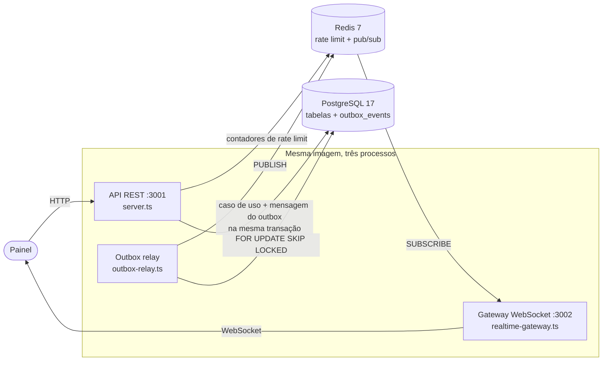
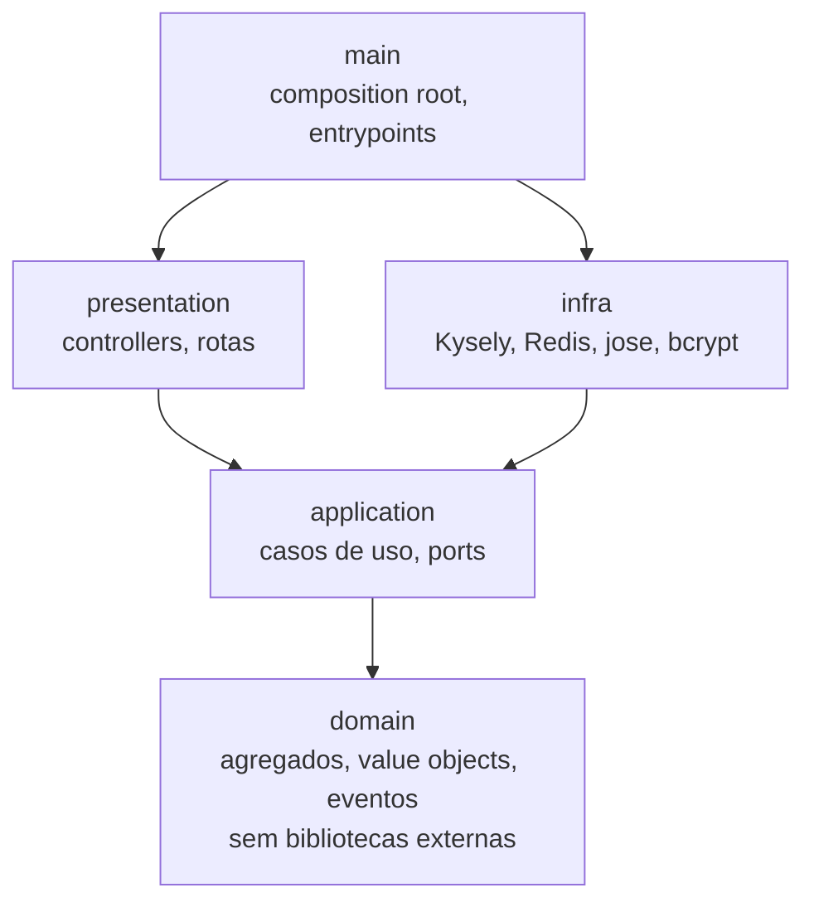
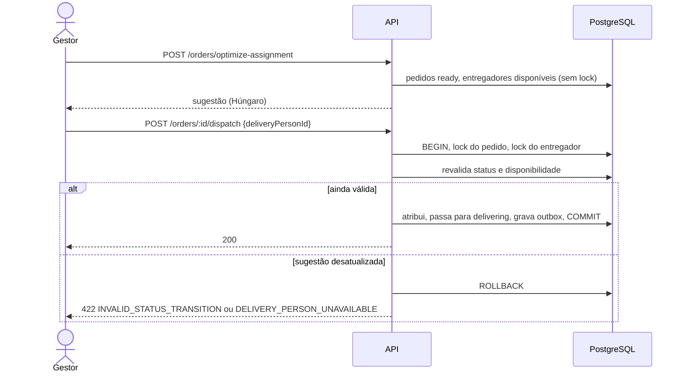

# DECISIONS — FastMeals

Este documento registra as decisões técnicas do projeto: por que cada biblioteca foi escolhida, como funciona o algoritmo de atribuição de entregadores, as decisões de arquitetura (no formato de ADRs, com alternativas e consequências), as mudanças no esquema de referência e as dificuldades encontradas.

> **Escopo atual:** o backend ([`backend/`](backend), com instruções em [`backend/README.md`](backend/README.md)). As decisões do frontend entram aqui quando ele for implementado.

## Sumário

1. [Visão geral](#1-visão-geral)
2. [Bibliotecas](#2-bibliotecas)
3. [Algoritmo de atribuição de entregadores](#3-algoritmo-de-atribuição-de-entregadores)
4. [Decisões de arquitetura (ADRs)](#4-decisões-de-arquitetura-adrs)
5. [Mudanças no esquema de referência](#5-mudanças-no-esquema-de-referência)
6. [Dificuldades encontradas e como foram resolvidas](#6-dificuldades-encontradas-e-como-foram-resolvidas)
7. [Limitações conhecidas e próximos passos](#7-limitações-conhecidas-e-próximos-passos)

---

## 1. Visão geral

O backend é um **monólito modular**: um repositório, uma imagem Docker e três processos com responsabilidades diferentes.



Dentro do código, cada **bounded context** (`identity`, `catalog`, `ordering`, `delivery`, `reporting`, `realtime`) tem as camadas `domain → application → infra → presentation` e é montado em `main/`. Um `shared-kernel` guarda o que é comum (agregados, eventos, unit of work, HTTP, paginação, datas).



As setas são as únicas dependências permitidas, e isso é verificado por testes de arquitetura ([ADR-11](#adr-11--regras-de-arquitetura-verificadas-por-testes)).

---

## 2. Bibliotecas

Critério geral: cada biblioteca resolve um problema concreto que não vale reimplementar, e fica **presa à camada de infra ou de apresentação**. O domínio e os casos de uso não importam nenhuma delas (exceto Zod na validação de entrada), então trocar qualquer uma afeta só um adapter.

### Produção

| Biblioteca | Para quê | Por que ela | Alternativas consideradas |
|---|---|---|---|
| **Fastify 5** | Servidor HTTP da API e do gateway | Erros de handlers `async` tratados nativamente; plugins encapsulados (cookie, rate limit, websocket) mantidos pelo próprio time; `inject()` para testes e2e sem abrir porta; bom desempenho de serialização. O Fastify só aparece em `presentation`/`main`: controllers recebem um `HttpRequest` próprio. | **Express 5**: tratamento async chegou só na v5 e quase tudo vem de middlewares de terceiros. **Koa**: minimalista demais para rate limit, cookies e websocket integrados. |
| **Kysely** + **pg** | Acesso ao PostgreSQL e migrations | Query builder com tipos inferidos do schema, mas é SQL: os relatórios agrupam por dia local de São Paulo, o relay usa `FOR UPDATE SKIP LOCKED`, as escritas usam `FOR UPDATE`/`FOR SHARE`, e existem índices parciais e trigram. Tudo isso é natural em Kysely e trabalhoso num ORM. Não impõe modelo: o agregado é do domínio e um mapper converte linha ↔ agregado. `pg` é o driver padrão, com pool. | **Prisma** / **TypeORM**: o modelo gerado (ou com decorators) compete com o agregado DDD, e locks, `SKIP LOCKED` e agregações com fuso acabariam em SQL cru. **Drizzle**: alternativa próxima; Kysely foi escolhido por ser só query builder (sem camada de ORM) e ter migrations simples em TypeScript. **Knex**: tipagem fraca. |
| **ioredis** | Rate limit distribuído e pub/sub do tempo real | Reconexão automática, scripts Lua (o contador faz `INCR` + `PEXPIRE` atomicamente), suporte a Cluster/Sentinel se o Redis crescer, conexão dedicada para `SUBSCRIBE`. | **node-redis**: equivalente; ioredis tem API de Lua e reconexão mais diretas. |
| **jose** | Emissão e verificação de JWT (HS256) | Implementação fiel às RFCs, sem dependências, API `async`, validação de `audience`/`issuer`/expiração embutida (access e refresh usam segredos e audiences diferentes). | **jsonwebtoken**: API de callbacks, CommonJS, menos rigor por padrão. |
| **@node-rs/bcrypt** | Hash de senhas (custo ≥ 10) | bcrypt nativo (Rust) que roda **fora do event loop**, com binários pré-compilados (sem `node-gyp` no Docker). Um login não trava as outras requisições. | **bcryptjs**: JavaScript puro, bloqueia o event loop e é várias vezes mais lento. **bcrypt**: nativo, mas compila com `node-gyp`. **argon2**: mais moderno, mas o enunciado pede bcrypt. |
| **Zod 4** | Validação de entrada HTTP, variáveis de ambiente e `seed/data.json` | Esquema e tipo TypeScript da mesma fonte; mensagens em português por campo; coerção de query string. Cada processo valida o ambiente no boot e falha com mensagem clara. | **JSON Schema do Fastify** (Ajv): prenderia a validação ao framework e não daria o tipo. **class-validator**: depende de decorators e classes. |
| **@fastify/cookie** | Cookie `httpOnly` do refresh token | Plugin oficial, com as opções `httpOnly`/`SameSite`/`Secure`/`Path`. | — |
| **@fastify/rate-limit** | 100 req/min por IP | Plugin oficial com `Retry-After`; aceita um *store* customizado, que aponta para o contador no Redis (limite compartilhado entre réplicas). | Middleware próprio: reimplementaria cabeçalhos e janela. |
| **@fastify/websocket** + **ws** | Gateway em tempo real | Integra o WebSocket ao ciclo de vida do Fastify (health check, shutdown) usando `ws`, a implementação mais usada e estável em Node. `ws` é dependência direta para não ser embutida no bundle ([dificuldade 5](#6-dificuldades-encontradas-e-como-foram-resolvidas)). | **Socket.IO**: protocolo próprio, fallback para long polling e cliente obrigatório; para um painel moderno, WebSocket puro basta. **SSE**: serviria (o fluxo é só servidor → cliente), mas WebSocket deixa a reautenticação na mesma conexão. |

### Desenvolvimento e testes

| Biblioteca | Para quê | Por que ela |
|---|---|---|
| **TypeScript** (estrito) | Linguagem | `strict`, `noUncheckedIndexedAccess`, `exactOptionalPropertyTypes`, sem `any`. Resolução `Bundler`: imports sem `.js`. |
| **tsx** | `npm run dev` | Executa TypeScript direto, com recarga, sem build. |
| **tsup** | Build de produção | Um bundle ESM por entrypoint (API, relay, gateway, migrate, seed) com esbuild; dependências ficam externas. Resolve os imports sem extensão, que o `tsc` puro não emitiria de forma executável. |
| **Vitest** | Testes | ESM e TypeScript nativos (o Jest ainda trata ESM como experimental), *projects* separando unit / architecture / integration / e2e, *fake timers* para o relay e o gateway. |
| **Testcontainers** | PostgreSQL e Redis reais nos testes | Constraints, locks, `EXPLAIN`, fusos e concorrência só são testados de verdade no banco real. Os containers sobem uma vez por execução e são destruídos ao final. Nada a configurar à mão. |
| **ArchUnitTS** | Testes de arquitetura | As regras de camadas, contextos e convenções viram testes do Vitest, com mensagens claras. Alternativas: **dependency-cruiser** (configuração JSON fora da suíte de testes) e **eslint-plugin-boundaries** (só dependências, sem regras de conteúdo como "todo caso de uso implementa `UseCase`"). |

`npm audit` está zerado. A única vulnerabilidade herdada (via ArchUnitTS, sem correção publicada) foi neutralizada com um `overrides` restrito ([dificuldade 9](#6-dificuldades-encontradas-e-como-foram-resolvidas)).

---

## 3. Algoritmo de atribuição de entregadores

Código: [`hungarian.ts`](backend/src/delivery/domain/dispatch/algorithms/hungarian.ts), [`dispatch-optimizer.ts`](backend/src/delivery/domain/dispatch/services/dispatch-optimizer.ts), [`geo-point.ts`](backend/src/delivery/domain/location/geo-point.ts), [`suggest-assignment.usecase.ts`](backend/src/delivery/application/usecases/suggest-assignment/suggest-assignment.usecase.ts).

### 3.1 O problema

Dados `n` pedidos `ready` e `m` entregadores disponíveis, escolher pares pedido → entregador tal que:

- cada entregador recebe **no máximo um** pedido e cada pedido **no máximo um** entregador;
- o número de pares é o máximo possível, `k = min(n, m)`;
- a **soma das distâncias** entre cada entregador e o seu pedido é mínima.

É o **problema de atribuição** (emparelhamento perfeito de custo mínimo num grafo bipartido). A versão retangular (`n ≠ m`) é o caso normal aqui.

**Quem entra no cálculo:**

- **Pedidos:** todos os `ready`, inclusive os que já têm entregador atribuído (o gestor pode redistribuir).
- **Entregadores:** ativos, não removidos, sem pedido `delivering` e **com localização conhecida**. Os sem GPS são devolvidos em `unlocatedDeliveryPersons`, para o painel mostrar por que não foram usados.

### 3.2 Distância: Haversine

Distância geodésica sobre uma esfera de raio médio `R = 6371 km`:

```
a = sin²(Δφ/2) + cos φ1 · cos φ2 · sin²(Δλ/2)
c = 2 · atan2(√a, √(1 − a))
d = R · c
```

Para distâncias urbanas, o erro de tratar a Terra como esfera (≈ 0,5%) é muito menor que a diferença entre linha reta e rota real. A distância por ruas exigiria um serviço de rotas (OSRM, Google), fora do escopo; ver [limitações](#7-limitações-conhecidas-e-próximos-passos).

### 3.3 Algoritmo Húngaro (Kuhn–Munkres) com potenciais

A implementação é a versão O(n²·m) com **potenciais duais** (`u` nas linhas, `v` nas colunas), que insere uma linha por vez:

1. Mantém a invariante `custo[i][j] − u[i] − v[j] ≥ 0` (custo reduzido não negativo).
2. Para cada linha nova, procura o **caminho aumentante de menor custo reduzido** até uma coluna livre, num laço parecido com o de Dijkstra. A cada passo, ajusta os potenciais pelo menor custo reduzido encontrado (`delta`), o que cria pelo menos uma aresta de custo reduzido zero.
3. Ao achar uma coluna livre, inverte o caminho: cada coluna do caminho passa para a linha anterior, e a linha nova entra no emparelhamento.
4. No fim, as arestas de custo reduzido zero formam o emparelhamento ótimo (a dualidade de programação linear garante a otimalidade).

**Matriz retangular.** O algoritmo exige `linhas ≤ colunas`. O otimizador monta a matriz com o lado menor nas linhas: pedidos × entregadores quando há mais entregadores, e a **transposta** (entregadores × pedidos) quando há mais pedidos. Assim nunca é preciso completar a matriz com linhas fictícias de custo zero, que fariam o trabalho subir para O(K³).

**Determinismo.** Pedidos e entregadores são ordenados por ID antes do cálculo, e em caso de empate de custo vence a coluna de menor índice. A mesma entrada gera sempre o mesmo plano: o painel não "pisca" com sugestões diferentes a cada clique, e os testes são reprodutíveis.

### 3.4 Complexidade

Com `k = min(n, m)` e `K = max(n, m)`:

| Etapa | Tempo | Memória |
|---|---|---|
| Matriz de distâncias (Haversine) | O(n·m) | O(n·m) |
| Húngaro | O(k²·K) | O(K) extra |
| **Total** | **O(n·m + k²·K)** | **O(n·m)** |

No cenário do enunciado (50 pedidos × 30 entregadores), são cerca de 30² × 50 = 45 mil passos internos.

### 3.5 Casos de borda

| Situação | Resultado |
|---|---|
| Nenhum entregador disponível | Nenhuma atribuição; todos os pedidos em `unassigned` com `reason: "No available delivery person"` |
| Nenhum pedido `ready` | Resposta vazia (`assignments: []`, `totalDistanceKm: 0`) |
| Mais pedidos que entregadores | Os `m` pares de menor distância total; os demais pedidos em `unassigned` |
| Mais entregadores que pedidos | Todo pedido atribuído; entregadores excedentes ficam livres |
| Entregador sem localização | Fora do cálculo, listado em `unlocatedDeliveryPersons` |
| Entregador inativo, removido ou em entrega | Não é candidato |
| Empates de distância | Desempate determinístico por ID |
| Coordenadas inválidas | Recusadas na criação do `GeoPoint` (latitude fora de ±90, longitude fora de ±180, valores não finitos) |

### 3.6 Benchmark

Instâncias aleatórias na região de São Paulo, com semente fixa. Mediana do tempo do Húngaro (sem montar a matriz) e quanto **mais distância total** as heurísticas gulosas produzem em relação ao ótimo. Medido num Apple M2 com Node 24.

| Pedidos × entregadores | Húngaro | Guloso por pedido¹ | Guloso global² |
|---|---|---|---|
| 10 × 6 | 0,04 ms | +65% | +0,8% |
| **50 × 30 (enunciado)** | **0,15 ms** | **+129%** | **+6%** |
| 100 × 100 | 3,3 ms | +38% | +25% |
| 200 × 150 | 3,6 ms | +138% | +10% |
| 500 × 500 | 175 ms | +52% | +31% |
| 1000 × 1000 | 2,0 s | +54% | +39% |

¹ *Nearest neighbor*: cada pedido, em sequência, pega o entregador livre mais próximo.
² Ordena todos os pares por distância e aceita os que não conflitam.

Leitura:

- No cenário do enunciado, o ótimo custa **0,15 ms**, quatro ordens de grandeza abaixo do limite de 2 s. O endpoint inteiro (consultas no PostgreSQL incluídas) fica bem abaixo disso, verificado por teste automatizado.
- As heurísticas gulosas economizam pouco tempo e pagam caro em distância. O guloso por pedido chega a **mais que dobrar** a distância total, porque os primeiros pedidos "roubam" entregadores que fariam mais falta aos seguintes.
- O crescimento é cúbico. Acima de ~1000 × 1000 o tempo se aproxima de segundos; ver [limitações](#7-limitações-conhecidas-e-próximos-passos).

### 3.7 Alternativas consideradas

| Abordagem | Ótimo? | Complexidade | Por que não |
|---|---|---|---|
| Força bruta (permutações) | Sim | O(K!/(K−k)!) | Inviável já com ~12 entregadores. Usada **só nos testes**, como oráculo. |
| Guloso por pedido (nearest neighbor) | Não | O(n·m) | Até +138% de distância no benchmark; o resultado depende da ordem dos pedidos. |
| Guloso global (pares ordenados) | Não | O(n·m·log(n·m)) | Melhor que o anterior, mas +6% a +39% acima do ótimo, sem garantia. |
| Min-cost max-flow / solver de PL | Sim | Maior constante | Mais genéricos e mais código (ou uma dependência de solver) para o mesmo resultado. |
| **Húngaro com potenciais** | **Sim** | **O(k²·K)** | **Escolhido:** ótimo, determinístico, ~80 linhas sem dependências e rápido o bastante com folga. |

### 3.8 Sugestão separada da decisão

`POST /api/orders/optimize-assignment` **só sugere**: não altera nada e não trava linhas. O gestor aceita cada par com `POST /api/orders/:id/dispatch`, que numa única transação trava o pedido e o entregador (`FOR UPDATE`), revalida tudo e passa o pedido para `delivering`.



**Prós:** o cálculo pode rodar quantas vezes o gestor quiser sem efeito colateral, e uma sugestão desatualizada (outro gestor despachou antes) nunca corrompe o estado. **Contra:** um clique a mais por pedido.

### 3.9 Como é testado

- Comparação com a **força bruta** em instâncias aleatórias com semente fixa: o custo total do Húngaro é sempre o ótimo.
- Cenários com solução, sem entregadores, sem pedidos, mais pedidos que entregadores e o inverso, empates e entregadores sem GPS.
- Um caso em que o guloso erra e o Húngaro acerta.
- **50 pedidos × 30 entregadores em menos de 2 s**, em memória e no PostgreSQL real.
- E2e do fluxo da tela: sugerir, aceitar cada par, sugestão desatualizada e `403` para o perfil `viewer`.

---

## 4. Decisões de arquitetura (ADRs)

Cada ADR traz contexto, decisão, alternativas e consequências (prós e contras).

### ADR-01 — Monólito modular com bounded contexts e Clean Architecture

- **Contexto.** O domínio tem regras de verdade: máquina de estados do pedido, snapshot de preço, disponibilidade de entregador, relatórios com fuso. O enunciado sugere uma estrutura e pede justificativa se ela mudar.
- **Decisão.** Um módulo por bounded context (*screaming architecture*: as pastas dizem "pedidos", "entregadores", e não "controllers", "services"), cada um com `domain`, `application`, `infra` e `presentation`. O domínio é TypeScript puro. Contextos não importam o código uns dos outros: quando um precisa de um fato do outro, pergunta por uma **camada anticorrupção** (ACL), uma porta da aplicação implementada na infra:

  | Quem pergunta | Porta | O que quer saber |
  |---|---|---|
  | Ordering | `ProductCatalog` | Preço e disponibilidade atuais do produto (snapshot no pedido) |
  | Ordering | `DeliveryPersonDirectory` | Se o entregador está ativo e livre; nome para exibir |
  | Catalog | `ActiveOrdersChecker` | Se o produto está em pedidos `pending`/`preparing` (bloqueia a remoção) |
  | Delivery | `DispatchBoard` | Pedidos `ready` e entregas em andamento |

- **Alternativas.** *MVC em camadas técnicas* (`controllers/`, `services/`, `models/`): mais rápido de começar, mas as regras se espalham e qualquer arquivo importa qualquer outro. *Microsserviços*: isolamento real, mas com custo operacional (deploys, rede, consistência eventual em tudo) desproporcional ao tamanho do problema.
- **Consequências.** ➕ Regras testáveis sem banco nem HTTP (80 arquivos de teste unitário rodam em ~4 s); trocar Fastify ou Kysely afeta só adapters; cada contexto pode virar um serviço depois, porque já conversa por contratos. ➖ Mais arquivos e mapeamentos (DTO ↔ agregado ↔ linha) do que um CRUD simples exigiria. ➖ As ACLs leem tabelas de outros contextos no mesmo banco: o acoplamento existe no nível do SQL. Foi aceito para manter as verificações na **mesma transação** (ex.: remover produto × criar pedido), e está concentrado em poucos adapters.

### ADR-02 — Kysely (query builder) em vez de ORM

- **Contexto.** Relatórios agregados com fuso, locks pessimistas, `SKIP LOCKED` no outbox, índices parciais e de trigram, listagens com < 200 ms para 10 mil linhas.
- **Decisão.** Kysely com tipos por contexto (o `CatalogDatabase` só enxerga `products` e `outbox_events`). Migrations em TypeScript, cada contexto com as suas, unidas num provider estático. Mappers explícitos linha ↔ agregado.
- **Alternativas.** Prisma, TypeORM, Drizzle (ver [Bibliotecas](#2-bibliotecas)).
- **Consequências.** ➕ SQL previsível, validado por testes de performance com `EXPLAIN` que confirmam o índice usado. ➕ O agregado não carrega anotações de persistência. ➖ Mais código de mapeamento e de upsert do que um ORM geraria.

### ADR-03 — Unit of Work e repositórios só para raízes de agregado

- **Contexto.** Um caso de uso altera um agregado, publica eventos e às vezes consulta uma ACL; tudo precisa confirmar ou desfazer junto.
- **Decisão.** Todo caso de uso roda dentro de `unitOfWork.transaction(...)`, e os repositórios **só existem dentro da transação**. Há um repositório por raiz de agregado (`Product`, `Order`, `DeliveryPerson`, `User`, `RefreshSession`), que serve também às leituras com filtros e paginação. O `Reporting`, que não tem agregados, usa portas de consulta somente leitura.
- **Alternativas.** Repositórios com transação implícita por chamada (perde a atomicidade entre agregado e outbox). Separar leitura e escrita em modelos diferentes (CQRS completo): mais estrutura do que o volume de leitura justifica. A primeira versão tinha uma porta de consulta separada para produtos, que foi unificada no repositório.
- **Consequências.** ➕ Não existe escrita fora de transação, e os fakes em memória do UoW reproduzem commit e rollback nos testes unitários. ➖ Leituras simples também passam pela transação (custo baixo no PostgreSQL).

### ADR-04 — Eventos de domínio com mediator em memória e transactional outbox

- **Contexto.** Mudanças em pedidos precisam chegar ao painel em tempo real, sem perder eventos se o processo cair entre gravar no banco e publicar.
- **Decisão.**
  1. Os agregados registram eventos de domínio (`OrderPlaced`, `OrderStatusChanged`, ...).
  2. Os repositórios só os **coletam**; o Unit of Work os entrega a um **mediator em memória**, ainda dentro da transação e antes do commit.
  3. Um *handler* decide o que sai do processo: o [`PublishOrderUpdateHandler`](backend/src/ordering/application/event-handlers/publish-order-update.handler.ts) converte os eventos de pedido numa mensagem pública versionada (`ordering.order-updates` v1, **sem dados pessoais do cliente**) e a grava na tabela `outbox_events`, na mesma transação.
  4. O [relay](backend/src/shared-kernel/infra/outbox/outbox-relay.ts) lê o outbox em lotes e publica no Redis.
- **Alternativas.** *Publicar no Redis direto do caso de uso*: perde o evento se o processo cair depois do commit, ou publica um evento de uma transação que vai falhar. *Todo evento de domínio no outbox automaticamente*: expõe a estrutura interna do domínio como contrato público. *CDC (Debezium) ou broker (Kafka/RabbitMQ)*: robustos, mas infraestrutura demais para um painel.
- **Consequências.** ➕ Consistência garantida pelo banco (o evento existe se, e só se, a mudança foi confirmada). ➕ O contrato público é separado do evento interno. ➖ Entrega **pelo menos uma vez** com latência de polling (padrão: até 500 ms); o cliente descarta repetidos pelo `id`.

### ADR-05 — Três processos: API, outbox relay e gateway WebSocket

- **Contexto.** Tempo real é diferencial no enunciado (polling de 30 s seria aceitável). Conexões WebSocket são longas e com estado; o relay é um laço contínuo.
- **Decisão.** Três entrypoints do mesmo código e da mesma imagem. O relay pode ter várias réplicas (`FOR UPDATE SKIP LOCKED` dá lotes disjuntos) e para no primeiro erro de publicação, para manter a ordem. O gateway pode ter várias réplicas (fan-out pelo Redis pub/sub).
- **Protocolo do gateway.** Autenticação pela **primeira mensagem** `{ type: "auth", accessToken }` em até 5 s. O navegador não envia `Authorization` em WebSocket, e token na URL vazaria em logs de proxy. Além disso: allowlist de `Origin` antes do upgrade, *heartbeat* ping/pong de 30 s, limite de 4 KB por mensagem, *backpressure* de 1 MB (cliente lento é desconectado com `1013`), reautenticação para estender a sessão e `1012` no shutdown para o cliente reconectar.
- **Alternativas.** WebSocket dentro da API: mais simples, mas um deploy da API derrubaria todos os painéis, e conexões longas competiriam com requisições curtas. Relay dentro da API: com N réplicas da API seriam N relays, acoplados ao ciclo de vida do HTTP.
- **Consequências.** ➕ Cada processo escala, reinicia e tem health check próprio. ➖ Mais serviços para operar; o pub/sub não guarda mensagens, então o cliente recarrega a lista pela API ao reconectar.

### ADR-06 — Access token em memória e refresh token rotativo em cookie `httpOnly`

- **Contexto.** O enunciado considera grave guardar tokens no frontend fora de cookie `httpOnly`.
- **Decisão.**
  - **Access token:** JWT HS256 de 15 min, devolvido no corpo e mantido só em memória pelo frontend.
  - **Refresh token:** 7 dias, **somente** num cookie `httpOnly`, `SameSite=Strict`, `Path=/api/auth`, com `Secure` em produção. O banco guarda só o SHA-256 dele.
  - **Rotação:** cada `/auth/refresh` invalida o refresh token anterior. **Reusar um já rotacionado revoga a sessão inteira**, porque é sinal de roubo.
  - **Login:** o tempo de resposta não revela se o email existe (o hash é comparado mesmo para usuário inexistente), e tentativas falhas por email + IP são limitadas.
- **Alternativas.** *Access token em `localStorage`*: vulnerável a XSS. *Access token também em cookie*: exigiria proteção CSRF em toda rota; com `SameSite=Strict` e o cookie restrito a `/api/auth`, o CSRF só alcança o refresh, que não faz nada útil para um atacante. *Sessão no servidor para tudo*: uma consulta por requisição, e o gateway WebSocket precisaria do banco.
- **Consequências.** ➕ Um XSS não consegue ler o refresh token, e um token roubado tem vida curta e é detectado no reuso. ➖ O frontend precisa renovar o access token antes de expirar e ao recarregar a página. ➖ Revogar um access token emitido exige esperar a expiração (15 min).

### ADR-07 — Rate limit compartilhado no Redis

- **Decisão.** 100 req/min por IP pelo `@fastify/rate-limit`, com o contador num script Lua atômico no Redis, compartilhado entre réplicas da API. `TRUST_PROXY` aceita uma lista de IPs/CIDRs ou um número de saltos (nunca "confiar em todos"), para que o limite valha para o IP real do cliente e não possa ser burlado com `X-Forwarded-For` falso.
- **Alternativa.** Contador em memória: com duas réplicas, o limite efetivo dobraria.
- **Consequências.** ➕ Limite correto em qualquer número de réplicas. ➖ Dependência do Redis: se ele cair, o limite é ignorado (*fail-open*) para não derrubar a API, e o `/api/health` reporta o estado degradado.

### ADR-08 — Concorrência: locks pessimistas e índice único parcial

- **Contexto.** Dois gestores podem mudar o mesmo pedido ou despachar o mesmo entregador ao mesmo tempo.
- **Decisão.**
  - Toda escrita lê o agregado com `findByIdForUpdate` (`SELECT … FOR UPDATE`): sem *lost update*.
  - O despacho trava o pedido e depois o entregador, sempre nessa ordem, e só então verifica se o entregador já tem entrega em andamento ([dificuldade 2](#6-dificuldades-encontradas-e-como-foram-resolvidas)).
  - Remover um entregador usa o mesmo lock, então espera o despacho em curso terminar e responde `409`.
  - **Defesa em profundidade:** o índice único parcial `uq_orders_one_delivery_per_person ON orders (delivery_person_id) WHERE status = 'delivering'` garante no banco que um entregador nunca tenha duas entregas, mesmo se uma regra falhar.
- **Alternativas.** *Lock otimista com coluna de versão*: bom com pouca disputa, mas devolveria erros de conflito ao gestor em vez de serializar. *Isolamento `SERIALIZABLE`*: exigiria repetir transações em toda escrita.
- **Consequências.** ➕ Testes de integração com transações paralelas reais provam que não há atualização perdida nem despacho duplo. ➖ Transações curtas esperam umas pelas outras no mesmo pedido, o que é o comportamento desejado.

### ADR-09 — Dinheiro em centavos, datas no fuso de São Paulo e relatórios pela data da entrega

- **Decisão.**
  - **Dinheiro:** o value object `Money` calcula em centavos inteiros (sem erro de ponto flutuante), o banco guarda `numeric(10,2)` e a API expõe reais (`65.8`).
  - **Datas:** filtros `startDate`/`endDate` são dias locais de `America/Sao_Paulo`, com as duas pontas inclusivas, convertidos para o intervalo `[início, fim)` em UTC via `Intl` (considera o horário de verão histórico). Receita é agrupada por dia local.
  - **Relatórios:** receita, mais vendidos e tempo de entrega consideram só pedidos `delivered`, **pela data da entrega**, lida da tabela `order_status_history`. "Pedidos por status" usa a data de criação.
  - **Limites:** o período da receita tem no máximo 366 dias, para proteger o banco.
- **Alternativa.** Usar `created_at` para tudo: um pedido criado às 23h50 e entregue no dia seguinte contaria como receita do dia errado, e não haveria como medir o tempo de entrega.
- **Consequências.** ➕ Números que batem com a operação real (o dia do restaurante não é o dia UTC). ➖ Uma tabela a mais para manter.

### ADR-10 — Soft delete para produtos e entregadores

- **Decisão.** `deleted_at` em `products` e `delivery_persons`. Removidos somem das listagens e não podem ser usados em pedidos novos, mas pedidos antigos continuam exibindo o produto e o entregador. A remoção é bloqueada (`409`) quando o produto está em pedido `pending`/`preparing` ou o entregador está em entrega. Os índices das listagens são parciais (`WHERE deleted_at IS NULL`).
- **Alternativa.** Remoção física: quebraria as FKs de `order_items` e `orders`, ou exigiria `ON DELETE SET NULL`, perdendo o histórico.
- **Consequências.** ➕ Histórico e relatórios íntegros. ➖ Toda consulta de catálogo filtra removidos, garantido por testes.

### ADR-11 — Regras de arquitetura verificadas por testes

- **Decisão.** Testes com ArchUnitTS em [`backend/src/architecture/`](backend/src/architecture) verificam:
  - a direção das dependências entre camadas e a ausência de ciclos;
  - o isolamento entre contextos;
  - o domínio sem bibliotecas externas;
  - a aplicação, os controllers e as rotas sem banco, cache, HTTP ou criptografia;
  - as convenções de nomes e pastas (casos de uso, erros, eventos, repositórios, controllers e rotas).

  Cada regra falha se o padrão não selecionar nenhum arquivo, então nunca passa "por vazio".
- **Consequências.** ➕ A arquitetura não se degrada em silêncio: ao serem criados, os testes encontraram duas violações reais, corrigidas ([dificuldade 10](#6-dificuldades-encontradas-e-como-foram-resolvidas)). ➖ As regras de convenção precisam acompanhar mudanças intencionais de estrutura.

### ADR-12 — Testes: pirâmide com bancos reais

- **Decisão.** Testes ao lado do código, com o tipo no nome do arquivo:

  | Tipo | Arquivos | Cobre |
  |---|---|---|
  | `*.unit.spec.ts` | 80 | Domínio e casos de uso com fakes em memória |
  | `*.integration.spec.ts` | 15 | Repositórios, ACLs, consultas, outbox, Redis, seed, migrations — contra PostgreSQL e Redis reais |
  | `*.e2e.spec.ts` | 9 | API HTTP (`app.inject`) e clientes WebSocket reais |
  | `*.architecture.spec.ts` | 3 | Regras de arquitetura |

  Os testes de performance (listagens < 200 ms com 10 mil registros, com `EXPLAIN` confirmando o índice; otimização < 2 s) e de concorrência são automatizados.
- **Alternativa.** Mocks do banco: não pegariam constraints, locks, fusos ou um índice ignorado pelo planejador.
- **Consequências.** ➕ Confiança no que só o banco real mostra. ➖ Integração e e2e exigem Docker e são mais lentos (os unitários continuam rodando sem Docker).

### ADR-13 — Docker: uma imagem por aplicação e um Compose único na raiz

- **Decisão.**
  - **Imagem do backend:** multi-stage (`node:22-alpine`, usuário não root, só dependências de produção). Cada serviço escolhe o processo pelo comando. Só o `migrate` constrói a imagem; os outros a reaproveitam (vários serviços com `build` da mesma imagem fazem o BuildKit exportá-la em paralelo, e os exports colidem).
  - **Imagem do frontend:** build do Vite servido por nginx sem root, que faz o proxy de `/api` e `/realtime` para o backend na mesma origem (o cookie `httpOnly` funciona sem CORS), com SPA fallback, cache imutável dos assets e cabeçalhos de segurança (CSP).
  - **Compose único na raiz:** `docker compose up --build` sobe, nesta ordem, `postgres` e `redis` → `migrate` → `seed` → `api`, `outbox-relay` e `realtime` → `frontend`, todos com health check. Os scripts `npm run docker:*` do backend usam o mesmo arquivo para subir só o backend.
  - **Proxy confiável:** a rede do projeto tem sub-rede fixa e o nginx um IP fixo; a API confia só nele (`TRUST_PROXY`), então o rate limit por IP vê o cliente real e ninguém forja `X-Forwarded-For` chamando a porta 3001 direto.
  - **Contexto de build do backend:** a raiz do repositório, para levar o `seed/data.json`, filtrada por uma allowlist em `Dockerfile.dockerignore`.
- **Alternativa.** Um compose por aplicação (o do backend chegou a existir em `backend/`), unidos na raiz com `include`: duplica a configuração ou exige override, e o comando do enunciado fica na raiz de qualquer jeito.
- **Consequências.** ➕ Um comando, um arquivo, ambiente reproduzível, seed idempotente. ➖ A sub-rede fixa (`172.30.240.0/24`) pode conflitar com outra rede da máquina; nesse caso basta trocá-la (e o `TRUST_PROXY`) no compose.

---

## 5. Mudanças no esquema de referência

O esquema de [`docs/database-schema.md`](docs/database-schema.md) foi seguido, com as mudanças abaixo. As migrations ficam em cada contexto, em `backend/src/<contexto>/infra/persistence/migrations/`.

### Tabelas novas

| Tabela | Por quê |
|---|---|
| `order_status_history` | Uma linha por transição (`position`, `from_status`, `to_status`, `changed_at`). Dá a data real de entrega para receita, mais vendidos e tempo médio de entrega ([ADR-09](#adr-09--dinheiro-em-centavos-datas-no-fuso-de-são-paulo-e-relatórios-pela-data-da-entrega)) e serve de auditoria. A PK `(order_id, position)` torna o salvamento idempotente. |
| `refresh_sessions` | Sessões de refresh com rotação, expiração, revogação e motivo (`logout`, `reuse-detected`). Guarda só o SHA-256 do token ([ADR-06](#adr-06--access-token-em-memória-e-refresh-token-rotativo-em-cookie-httponly)). |
| `outbox_events` | Transactional outbox, com índice parcial dos pendentes ([ADR-04](#adr-04--eventos-de-domínio-com-mediator-em-memória-e-transactional-outbox)). |

### Colunas alteradas ou novas

| Tabela | Mudança | Por quê |
|---|---|---|
| todas | `id` sem `DEFAULT gen_random_uuid()` | O ID nasce no domínio (o agregado existe e emite eventos antes de ser salvo) |
| todas | `created_at`/`updated_at` `NOT NULL`, com trigger `set_updated_at()` | O domínio é a fonte do horário (via `Clock`); o trigger só preenche quando um `UPDATE` manual esquece a coluna |
| `users` | `password` → `password_hash varchar(60)` com `CHECK` do formato bcrypt e custo ≥ 10 | O nome diz o que é guardado; o banco recusa senha em texto puro mesmo se o código falhar |
| `users` | `CHECK (email = lower(email))` | Unicidade sem diferenciar maiúsculas |
| `products`, `delivery_persons` | `deleted_at` | Soft delete ([ADR-10](#adr-10--soft-delete-para-produtos-e-entregadores)) |
| `delivery_persons` | `updated_at` | Ausente na referência; necessário porque o entregador é editado |
| `delivery_persons` | `CHECK` de que latitude e longitude são ambas nulas ou ambas preenchidas | Localização é um ponto |
| `order_items` | `product_name` (snapshot) | O pedido mostra o produto como era na compra, mesmo que ele seja renomeado ou removido |
| `order_items` | sem `created_at` | É sempre igual ao `created_at` do pedido |
| `orders` | `CHECK` de que `delivering`/`delivered` exigem `delivery_person_id` | A mesma regra do agregado, também no banco |
| várias | `CHECK` de tamanho de textos e formato de telefone `(11) 99999-1234` | As mesmas regras dos value objects, como defesa em profundidade |

### Índices

| Índice | Por quê |
|---|---|
| Índices de `products` com `WHERE deleted_at IS NULL` | As listagens nunca olham removidos: índices menores |
| `idx_products_name_trgm` (GIN, `pg_trgm`) | A busca parcial (`ILIKE '%termo%'`) não usa B-tree |
| `idx_products_price`, `idx_orders_total_amount` | Ordenação por preço e por valor |
| `(created_at DESC, id DESC)` e `(status, created_at DESC, id DESC)` | Paginação estável (desempate pelo ID) atendida pelo índice nas duas direções |
| `uq_orders_one_delivery_per_person` (único parcial) | Um entregador nunca tem duas entregas ([ADR-08](#adr-08--concorrência-locks-pessimistas-e-índice-único-parcial)) |
| `uq_order_items_order_product` | O agregado une linhas do mesmo produto; também substitui `idx_order_items_order_id` |
| `idx_order_status_history_to_changed` | Relatórios por período de entrega |
| `idx_refresh_sessions_user_id`, `idx_refresh_sessions_expires_at` | FK (o PostgreSQL não indexa FKs sozinho) e limpeza de sessões vencidas |
| Sem `idx_users_email` | A constraint `UNIQUE` já cria esse índice |

---

## 6. Dificuldades encontradas e como foram resolvidas

1. **Teste de concorrência que travava a si mesmo.** O helper que abre uma transação e a deixa bloqueada num lock era uma função `async` que devolvia a promise do resultado. Uma função `async` "desembrulha" a promise devolvida, então o helper só retornava quando a transação terminava, e ela esperava o próprio teste liberá-la (deadlock). **Solução:** devolver um objeto `{ outcome }` com a promise dentro. O helper foi para o shared kernel e é usado por todos os testes de concorrência.

2. **Despacho duplo apesar do lock.** O caminho óbvio, travar o entregador e verificar "tem entrega em andamento?" no mesmo comando SQL, tem uma armadilha: no `READ COMMITTED`, cada comando enxerga o snapshot de quando começou. Se o comando esperou o lock de outra transação, a verificação ainda vê o estado anterior a ela e deixa passar o segundo despacho. **Solução:** travar o entregador num comando e verificar num comando **seguinte**, que já enxerga o commit da outra transação. O índice único parcial ficou como rede de segurança, e um teste com transações paralelas reais cobre o cenário.

3. **Relay que não parava.** No shutdown, o laço do relay ainda dormia o intervalo de polling depois do `stop()`, atrasando o encerramento. **Solução:** não dormir quando o runner já foi parado; o lote em andamento termina e o processo sai. Testado com *fake timers*.

4. **Gateway fechava com `1005` em vez de `1012`.** No shutdown, o `preClose` padrão do `@fastify/websocket` encerrava os sockets antes do código da aplicação, e o cliente não sabia que devia reconectar. **Solução:** um `preClose` próprio, que fecha cada sessão com `1012` (servidor reiniciando). Coberto por teste e2e.

5. **Build de produção quebrado só no Docker** (`Dynamic require of "events" is not supported`). O `ws` não era dependência direta, então o tsup o embutia no bundle ESM, e o código CommonJS dele quebrava. **Solução:** declarar `ws` como dependência direta, para ficar externo ao bundle.

6. **Imports com `.js`.** Com `moduleResolution: NodeNext`, todo import relativo precisava de `.js`, o que poluía o código. **Solução:** resolução `Bundler` com `noEmit`, `tsx` em desenvolvimento e `tsup` no build. Uma regra de arquitetura impede que `.js` ou `/index` voltem.

7. **Fuso e horário de verão nos relatórios.** "Dia 15" para o restaurante não é o dia 15 em UTC, e o Brasil teve horário de verão até 2019. **Solução:** converter cada dia local para o intervalo UTC com `Intl` (que conhece o histórico do fuso) e agrupar por `AT TIME ZONE 'America/Sao_Paulo'` no SQL. Há testes de borda (pedido entregue às 23h59 locais).

8. **Totais que não batiam na tela.** As distâncias de cada par são arredondadas para exibição; somar os valores sem arredondar dava um `totalDistanceKm` diferente da soma das linhas. **Solução:** o total é a soma dos valores exibidos.

9. **`npm audit` com 5 vulnerabilidades altas.** O ArchUnitTS traz `plantuml-parser → fast-glob → micromatch → braces`, com um alerta ([GHSA-vfj7-8cjw-p6xm](https://github.com/advisories/GHSA-vfj7-8cjw-p6xm)) sem versão corrigida. Lendo o código, o ArchUnitTS só usa o `parse(texto)` do `plantuml-parser`, e o `fast-glob` só é chamado ao ler arquivos de diagrama, o que nunca acontece. **Solução:** um `overrides` **restrito ao `plantuml-parser`** que troca o `fast-glob` pelo `tinyglobby` (sem `braces`). Resultado: `npm audit` zerado, e os testes de arquitetura continuam passando. Nada disso entra na imagem de produção.

10. **Os testes de arquitetura acharam violações reais.** A camada de aplicação do `realtime` dependia de um contrato da camada de apresentação do shared kernel, e 45 imports usavam `/index`. **Solução:** uma porta `RealtimeAuthenticator` na aplicação do `realtime` e a limpeza dos imports. Também houve limitações do ArchUnitTS a contornar: o nome do arquivo vem sem extensão, e padrões com dois `**` não selecionam nada. Foram criados helpers para isso, e cada regra foi validada injetando uma violação de propósito e vendo o teste falhar.

---

## 7. Limitações conhecidas e próximos passos

- **Frontend:** as decisões do painel serão adicionadas aqui.
- **Distância em linha reta.** Haversine ignora ruas, rios e trânsito. Com um serviço de rotas, bastaria trocar a função de custo da matriz; o algoritmo continua o mesmo.
- **Escala do otimizador.** O(k²·K) responde em milissegundos até centenas de pedidos, mas chega a ~2 s com 1000 × 1000. Nessa escala, o caminho seria dividir por região (o otimizador por bairro) ou limitar os candidatos aos mais próximos de cada pedido.
- **Tempo real sem histórico.** O Redis pub/sub não guarda mensagens: quem reconecta recarrega a lista pela API. Com requisitos de replay, o próximo passo seria Redis Streams.
- **Revogação imediata de access token.** Hoje vale até expirar (15 min). Se for necessária, uma denylist curta no Redis resolveria.
